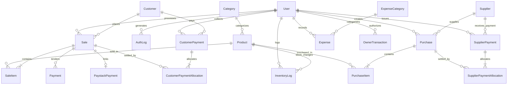

# NexTill POS - Complete Database Design & Architecture Specification

**Database Engine**: PostgreSQL 15+  
**ORM**: Prisma ORM (v5)  
**Primary Key Convention**: UUID v4 (`@default(uuid())`) across all primary entities  
**Currency & Precision Handling**: `Decimal(10, 2)` for monetary values, `Decimal(14, 3)` for fractional quantities (weight, volume, count)  
**Specification Version**: 2.0  
**Last Updated**: November 2026  

---

## Table of Contents

1. [Architectural Overview](#1-architectural-overview)
2. [Entity Relationship Diagram (ERD)](#2-entity-relationship-diagram-erd)
3. [Global Enums](#3-global-enums)
4. [Functional Domain Modules](#4-functional-domain-modules)
   - [4.1 Identity, Access Management & Security](#41-identity-access-management--security)
   - [4.2 Catalog, Products & Multi-Unit System](#42-catalog-products--multi-unit-system)
   - [4.3 Point of Sale (POS) & Customer Billing](#43-point-of-sale-pos--customer-billing)
   - [4.4 Customer Credit, Accounts Receivable (AR) & Loyalty](#44-customer-credit-accounts-receivable-ar--loyalty)
   - [4.5 Online Payment Gateways (Paystack Reconciliation)](#45-online-payment-gateways-paystack-reconciliation)
   - [4.6 Procurement, Suppliers & Accounts Payable (AP)](#46-procurement-suppliers--accounts-payable-ap)
   - [4.7 Inventory Tracking & Stock Movement Audit](#47-inventory-tracking--stock-movement-audit)
   - [4.8 Financial Accounting: Expenses, Fixed Assets & Owner Equity](#48-financial-accounting-expenses-fixed-assets--owner-equity)
   - [4.9 Application Configuration](#49-application-configuration)
5. [Complete Table Dictionary & Field Specifications](#5-complete-table-dictionary--field-specifications)
6. [Entity Relationships & Integrity Rules](#6-entity-relationships--integrity-rules)
7. [Key Business Logic & Database Design Decisions](#7-key-business-logic--database-design-decisions)
8. [Indexes & Performance Optimizations](#8-indexes--performance-optimizations)

---

## 1. Architectural Overview

The NexTill POS database architecture is engineered for high-concurrency retail operations, fractional quantity measurement, accounting accuracy, and financial auditability.

```
       +-------------------------------------------------------+
       |               NexTill POS Core Architecture            |
       +-------------------------------------------------------+
            |                        |                       |
            v                        v                       v
 [ Sales & Billing ]      [ Inventory & Stock ]     [ Finance & Accounting ]
  - Cash / Card / MoMo     - Decimal(14,3) Precision - Double-Entry Allocations
  - Paystack Gateway       - Unit Conversions        - Operating Expenses
  - Customer AR Ledger     - Supplier AP Ledger      - Assets & Equity
```

### Core Design Standards
- **Strong Referential Integrity**: Strict foreign key constraints with explicit delete triggers (`Cascade`, `Restrict`, `SetNull`). Critical financial documents prevent deletion of parent products (`Restrict`).
- **Audit Immutability**: Historical financial records snapshot pricing, cost, and product details at the exact moment of sale/purchase. Future catalog modifications do not invalidate historical financial reports.
- **Fractional Unit Support**: All inventory quantities use `Decimal(14,3)` enabling precision sales by piece, weight (kg/g), or volume (L/ml).
- **Accounts Receivable & Payable via Allocation Tables**: Credit sales and bulk/installment payments are linked via dedicated junction allocation records (`CustomerPaymentAllocation` and `SupplierPaymentAllocation`), maintaining exact FIFO or targeted invoice balance tracking.

---

## 2. Entity Relationship Diagram (ERD)



---

## 3. Global Enums

| Enum Name | Allowed Values | Usage / Functional Scope |
|---|---|---|
| `Role` | `ADMIN`, `MANAGER`, `CASHIER` | Role-based access control (RBAC) governing application routes and administrative actions. |
| `PaymentMethod` | `CASH`, `MOBILE_MONEY`, `CARD`, `CREDIT` | Settlement method for sales, customer AR payments, supplier AP payments, expenses, and owner equity transactions. |
| `PaymentStatus` | `COMPLETED`, `PARTIALLY_PAID`, `REFUNDED`, `PENDING` | Payment lifecycle status of sales and purchase orders. |
| `PurchaseStatus` | `ORDERED`, `RECEIVED`, `CANCELLED` | Procurement fulfillment lifecycle. |
| `InventoryChangeType` | `SALE`, `RESTOCK`, `ADJUSTMENT`, `RETURN` | Audit category for physical and digital inventory movements. |
| `UnitCategory` | `COUNT`, `WEIGHT`, `VOLUME` | Classifies how a product is measured and priced. |
| `AssetStatus` | `ACTIVE`, `IN_REPAIR`, `DISPOSED`, `DEPRECIATED` | Lifecycle tracking for capital business equipment and company assets. |
| `OwnerTxType` | `CONTRIBUTION`, `WITHDRAWAL` | Distinguishes owner equity injections from owner drawings. |

---

## 4. Functional Domain Modules

### 4.1 Identity, Access Management & Security
- **`User`**: System operators with designated permissions (`ADMIN`, `MANAGER`, `CASHIER`). Features automated brute-force protection with `failed_login_attempts` tracking and `locked_until` lockouts.
- **`AuthLog`**: Security audit log recording IP address, user agent, event type (`LOGIN_SUCCESS`, `LOGIN_FAILED`, `LOGOUT`), and contextual details.

### 4.2 Catalog, Products & Multi-Unit System
- **`Category`**: Hierarchical grouping for products.
- **`Product`**: Central item master. Supports dual retail pricing (`usual_price` vs `our_price`), cost accounting (`cost_price`), multi-unit classifications (`COUNT`, `WEIGHT`, `VOLUME`), barcode scanning, low-stock alerts (`low_stock_threshold`), and soft-deletion (`is_active = false`).

### 4.3 Point of Sale (POS) & Customer Billing
- **`Sale`**: Master checkout record containing invoice number (`transaction_id`), cashier link, customer link, subtotal, discounts, tax, amounts paid/due, and loyalty points awarded.
- **`SaleItem`**: Individual invoice line item. Takes an immutable snapshot of item prices (`unit_price`, `unit_cost_snapshot`, `cost_price_snapshot`, `usual_price_snapshot`, `our_price_snapshot`, `predefined_discount_applied`), base quantities, and units.
- **`Payment`**: Multi-tender cash register records. Captures exact cash tender, change given, and external reference tokens.

### 4.4 Customer Credit, Accounts Receivable (AR) & Loyalty
- **`Customer`**: Client registry managing personal info, credit balances, and accumulated `loyalty_points`.
- **`CustomerPayment`**: Payments made by a customer to clear outstanding credit balances or advance deposits.
- **`CustomerPaymentAllocation`**: Ledger junction linking customer payments directly to specific unpaid credit `Sale` records, recalculating `amount_paid` and `balance_due`.

### 4.5 Online Payment Gateways (Paystack Reconciliation)
- **`PaystackPayment`**: Captures external webhook events (`charge.success`). Maintains currency, pesewas/cents amounts, customer emails, and payment matching against POS sales to handle interrupted network sessions or browser closures.

### 4.6 Procurement, Suppliers & Accounts Payable (AP)
- **`Supplier`**: Vendor master data including contact person, business details, and active status.
- **`Purchase`**: Purchase Order (PO) tracking incoming vendor shipments, received dates, total invoice amounts, and payable balances.
- **`PurchaseItem`**: Purchase invoice lines capturing product unit costs, quantities, and units at time of arrival.
- **`SupplierPayment`**: Outgoing payments made to suppliers for inventory restocks.
- **`SupplierPaymentAllocation`**: Maps outgoing supplier payments directly against open `Purchase` invoices.

### 4.7 Inventory Tracking & Stock Movement Audit
- **`InventoryLog`**: Immutable audit ledger recording every stock variation. Captures `previous_quantity`, `quantity_change`, `new_quantity`, the cashier/manager responsible, and the operational reason (`SALE`, `RESTOCK`, `ADJUSTMENT`, `RETURN`).

### 4.8 Financial Accounting: Expenses, Fixed Assets & Owner Equity
- **`ExpenseCategory`**: Operating expenditure classification (e.g., Utilities, Rent, Salaries, Marketing).
- **`Expense`**: Daily operational overhead cash outflows linked to payees and payment methods.
- **`BusinessAsset`**: Fixed asset register tracking equipment, computers, furniture, acquisition cost, and current depreciated book value.
- **`OwnerTransaction`**: Captures capital investments and owner drawings for balance sheet reconciliation.

### 4.9 Application Configuration
- **`Settings`**: Dynamic system configuration key-value storage (e.g., store name, tax rates, receipt headers, currency formatting, loyalty conversion rate).

---

## 5. Complete Table Dictionary & Field Specifications

### 5.1 `User`
Maintains credentials and authorization levels for all POS operators.

| Column | Type | Constraints | Description / Default |
|---|---|---|---|
| `id` | `String` | PK, UUID | Unique user identifier |
| `username` | `String` | Unique, Not Null | Unique login username |
| `email` | `String` | Unique, Not Null | Unique corporate/staff email |
| `password_hash` | `String` | Not Null | Bcrypt encrypted hash (cost factor 12) |
| `full_name` | `String` | Not Null | Staff member full name |
| `role` | `Role` | Enum, Default: `CASHIER` | `ADMIN`, `MANAGER`, or `CASHIER` |
| `is_active` | `Boolean` | Default: `true` | Soft-deactivation toggle |
| `failed_login_attempts` | `Int` | Default: `0` | Consecutive failed attempts counter |
| `locked_until` | `DateTime` | Nullable | Expiry timestamp for security lockouts |
| `created_at` | `DateTime` | Default: `now()` | Timestamp of creation |
| `updated_at` | `DateTime` | Auto-update | Timestamp of last modification |

---

### 5.2 `Category`
Product category classification.

| Column | Type | Constraints | Description / Default |
|---|---|---|---|
| `id` | `String` | PK, UUID | Unique category identifier |
| `name` | `String` | Unique, Not Null | Category label |
| `description` | `String` | Nullable | Optional category details |
| `created_at` | `DateTime` | Default: `now()` | Timestamp of creation |
| `updated_at` | `DateTime` | Auto-update | Timestamp of last modification |

---

### 5.3 `Product`
Inventory catalog item master.

| Column | Type | Constraints | Description / Default |
|---|---|---|---|
| `id` | `String` | PK, UUID | Unique product identifier |
| `name` | `String` | Not Null | Product commercial name |
| `sku` | `String` | Unique, Indexed | Stock Keeping Unit code |
| `barcode` | `String` | Unique, Indexed, Nullable | EAN/UPC barcode string |
| `category_id` | `String` | FK → `Category.id`, Nullable | Linked category (`onDelete: SetNull`) |
| `unit_category` | `UnitCategory` | Default: `COUNT` | `COUNT`, `WEIGHT`, or `VOLUME` |
| `base_unit` | `String` | Default: `"pcs"` | Storage unit (e.g., pcs, kg, l) |
| `pricing_unit` | `String` | Default: `"pcs"` | Selling unit displayed on shelf/receipt |
| `price` | `Decimal(10,2)` | Not Null | Standard active retail price |
| `usual_price` | `Decimal(10,2)` | Default: `0.00` | Regular retail price before store promo |
| `our_price` | `Decimal(10,2)` | Default: `0.00` | Discounted / special retail price |
| `cost_price` | `Decimal(10,2)` | Nullable | Current average purchasing/cost price |
| `quantity` | `Decimal(14,3)` | Default: `0.000` | Current on-hand stock |
| `low_stock_threshold`| `Decimal(14,3)` | Default: `10.000` | Alert threshold for reordering |
| `image_url` | `String` | Nullable | Asset path for product thumbnail |
| `is_active` | `Boolean` | Default: `true` | Soft-deletion flag |
| `created_at` | `DateTime` | Default: `now()` | Timestamp of creation |
| `updated_at` | `DateTime` | Auto-update | Timestamp of last modification |

---

### 5.4 `Customer`
Customer relationship and loyalty account.

| Column | Type | Constraints | Description / Default |
|---|---|---|---|
| `id` | `String` | PK, UUID | Unique customer identifier |
| `name` | `String` | Not Null | Customer full name |
| `phone` | `String` | Unique, Indexed, Nullable | Primary contact mobile number |
| `email` | `String` | Unique, Nullable | Customer email address |
| `address` | `String` | Nullable | Physical/delivery address |
| `loyalty_points` | `Int` | Default: `0` | Accumulated reward points balance |
| `created_at` | `DateTime` | Default: `now()` | Timestamp of creation |
| `updated_at` | `DateTime` | Auto-update | Timestamp of last modification |

---

### 5.5 `Sale`
Sales transaction header.

| Column | Type | Constraints | Description / Default |
|---|---|---|---|
| `id` | `String` | PK, UUID | Unique sale identifier |
| `transaction_id` | `String` | Unique, Indexed | Formatted receipt ID (`TXN-YYYYMMDD-NNNN`) |
| `user_id` | `String` | FK → `User.id` | Cashier who handled the sale |
| `customer_id` | `String` | FK → `Customer.id`, Nullable | Linked customer (`onDelete: SetNull`) |
| `subtotal` | `Decimal(10,2)` | Not Null | Net sum before discount and tax |
| `discount_amount`| `Decimal(10,2)` | Default: `0.00` | Cart-level discount applied |
| `tax_amount` | `Decimal(10,2)` | Default: `0.00` | Total tax applied |
| `total_amount` | `Decimal(10,2)` | Not Null | Final grand total due |
| `amount_paid` | `Decimal(10,2)` | Default: `0.00` | Cumulative amount settled |
| `balance_due` | `Decimal(10,2)` | Default: `0.00` | Remaining credit balance (`total - paid`) |
| `payment_method` | `PaymentMethod` | Not Null | Initial settlement mode (`CASH`, `CARD`, etc.) |
| `payment_status` | `PaymentStatus` | Default: `COMPLETED` | `COMPLETED`, `PARTIALLY_PAID`, `REFUNDED`, `PENDING` |
| `notes` | `String` | Nullable | Order notes or special instructions |
| `loyalty_points_earned` | `Int` | Default: `0` | Points awarded by this transaction |
| `refund_requested_at` | `DateTime` | Nullable | Timestamp if refund is pending approval |
| `refund_requested_by` | `String` | Nullable | Staff ID requesting the refund |
| `created_at` | `DateTime` | Default: `now()`, Indexed | Sale completion timestamp |
| `updated_at` | `DateTime` | Auto-update | Timestamp of last modification |

---

### 5.6 `SaleItem`
Line item within a sale, snapshotting exact commercial terms.

| Column | Type | Constraints | Description / Default |
|---|---|---|---|
| `id` | `String` | PK, UUID | Unique line identifier |
| `sale_id` | `String` | FK → `Sale.id` | Parent sale (`onDelete: Cascade`) |
| `product_id` | `String` | FK → `Product.id` | Target product (`onDelete: Restrict`) |
| `product_name` | `String` | Default: `""` | Name snapshot at time of checkout |
| `product_sku` | `String` | Default: `""` | SKU snapshot at time of checkout |
| `unit` | `String` | Default: `"pcs"` | Transaction unit sold |
| `quantity` | `Decimal(10,3)` | Not Null | Quantity sold |
| `base_quantity` | `Decimal(14,3)` | Default: `1.000` | Conversion quantity for stock reduction |
| `base_unit` | `String` | Default: `"pcs"` | Product's base storage unit |
| `pricing_unit` | `String` | Default: `"pcs"` | Selling unit of measure |
| `unit_price` | `Decimal(10,2)` | Not Null | Actual unit price charged |
| `unit_cost_snapshot` | `Decimal(10,2)` | Default: `0.00` | Item unit cost at time of sale |
| `cost_price_snapshot`| `Decimal(10,2)` | Nullable | Product's registered cost price |
| `usual_price_snapshot`| `Decimal(10,2)`| Default: `0.00` | Regular catalogue price snapshot |
| `our_price_snapshot` | `Decimal(10,2)` | Default: `0.00` | Promotion catalogue price snapshot |
| `predefined_discount_applied` | `Boolean` | Default: `false` | True if promotional discount was used |
| `predefined_discount_amount` | `Decimal(10,2)` | Default: `0.00` | Price difference (`usual_price - our_price`) |
| `line_cost` | `Decimal(10,2)` | Default: `0.00` | Total cost of line (`quantity * cost`) |
| `discount` | `Decimal(10,2)` | Default: `0.00` | Manual line-level discount |
| `total` | `Decimal(10,2)` | Not Null | Final line total (`(qty * price) - discount`) |
| `created_at` | `DateTime` | Default: `now()` | Timestamp of creation |
| `updated_at` | `DateTime` | Auto-update | Timestamp of last modification |

---

### 5.7 `Payment`
Payment tender record for a specific sale.

| Column | Type | Constraints | Description / Default |
|---|---|---|---|
| `id` | `String` | PK, UUID | Unique payment identifier |
| `sale_id` | `String` | FK → `Sale.id` | Parent sale (`onDelete: Cascade`) |
| `method` | `PaymentMethod` | Not Null | Settlement method used |
| `amount_paid` | `Decimal(10,2)` | Not Null | Actual tender handed by customer |
| `change_given` | `Decimal(10,2)` | Default: `0.00` | Change returned to customer |
| `reference` | `String` | Unique, Nullable | Transaction reference (Card auth, MoMo ref) |
| `created_at` | `DateTime` | Default: `now()` | Timestamp of payment |
| `updated_at` | `DateTime` | Auto-update | Timestamp of last modification |

---

### 5.8 `CustomerPayment`
Standalone payment collected from a customer against accounts receivable.

| Column | Type | Constraints | Description / Default |
|---|---|---|---|
| `id` | `String` | PK, UUID | Unique payment identifier |
| `customer_id` | `String` | FK → `Customer.id`, Indexed | Customer making payment (`onDelete: Cascade`) |
| `user_id` | `String` | FK → `User.id` | Cashier who received the money |
| `amount` | `Decimal(10,2)` | Not Null | Total payment amount collected |
| `payment_method` | `PaymentMethod` | Default: `CASH` | Settlement method |
| `reference` | `String` | Nullable | Receipt or bank deposit reference |
| `notes` | `String` | Nullable | Remarks |
| `created_at` | `DateTime` | Default: `now()`, Indexed | Timestamp of payment |
| `updated_at` | `DateTime` | Auto-update | Timestamp of last modification |

---

### 5.9 `CustomerPaymentAllocation`
Junction mapping customer credit settlements directly to outstanding sales.

| Column | Type | Constraints | Description / Default |
|---|---|---|---|
| `id` | `String` | PK, UUID | Unique allocation identifier |
| `customer_payment_id` | `String` | FK → `CustomerPayment.id`, Indexed | Source payment (`onDelete: Cascade`) |
| `sale_id` | `String` | FK → `Sale.id`, Indexed | Target credit sale (`onDelete: Cascade`) |
| `amount` | `Decimal(10,2)` | Not Null | Portioned amount applied to this sale |
| `created_at` | `DateTime` | Default: `now()` | Timestamp of allocation |

---

### 5.10 `InventoryLog`
Audit log of every stock alteration.

| Column | Type | Constraints | Description / Default |
|---|---|---|---|
| `id` | `String` | PK, UUID | Unique log entry identifier |
| `product_id` | `String` | FK → `Product.id` | Product altered (`onDelete: Restrict`) |
| `change_type` | `InventoryChangeType` | Not Null | `SALE`, `RESTOCK`, `ADJUSTMENT`, `RETURN` |
| `unit` | `String` | Default: `"pcs"` | Unit of measurement for the change |
| `quantity_change` | `Decimal(14,3)` | Not Null | Delta change (+ for stock-in, - for stock-out) |
| `previous_quantity` | `Decimal(14,3)` | Not Null | Balance prior to modification |
| `new_quantity` | `Decimal(14,3)` | Not Null | Resulting balance |
| `user_id` | `String` | FK → `User.id` | User accountable for the change |
| `notes` | `String` | Nullable | Reason for stock adjustment |
| `created_at` | `DateTime` | Default: `now()` | Timestamp of adjustment |
| `updated_at` | `DateTime` | Auto-update | Timestamp of last modification |

---

### 5.11 `AuthLog`
Security and login attempt audit trail.

| Column | Type | Constraints | Description / Default |
|---|---|---|---|
| `id` | `String` | PK, UUID | Unique log entry identifier |
| `user_id` | `String` | FK → `User.id`, Nullable | Linked operator (`onDelete: SetNull`) |
| `event_type` | `String` | Not Null | Event identifier (`LOGIN_SUCCESS`, `LOGIN_FAILED`) |
| `ip_address` | `String` | Nullable | Remote client IP address |
| `user_agent` | `String` | Nullable | Browser / Device user agent string |
| `details` | `String` | Nullable | JSON string or contextual details |
| `created_at` | `DateTime` | Default: `now()` | Timestamp of event |
| `updated_at` | `DateTime` | Auto-update | Timestamp of last modification |

---

### 5.12 `Settings`
Key-value application runtime configuration.

| Column | Type | Constraints | Description / Default |
|---|---|---|---|
| `id` | `String` | PK, UUID | Unique setting identifier |
| `key` | `String` | Unique, Not Null | Configuration key identifier |
| `value` | `String` | Not Null | Serialized string or JSON value |
| `created_at` | `DateTime` | Default: `now()` | Timestamp of creation |
| `updated_at` | `DateTime` | Auto-update | Timestamp of last modification |

*Standard Keys*: `store_name`, `store_address`, `store_phone`, `currency_symbol`, `tax_rate`, `loyalty_points_rate`, `receipt_footer`.

---

### 5.13 `PaystackPayment`
Reconciliation and webhook capture for online Paystack transactions.

| Column | Type | Constraints | Description / Default |
|---|---|---|---|
| `id` | `String` | PK, UUID | Unique record identifier |
| `reference` | `String` | Unique, Not Null | Paystack transaction reference |
| `amount` | `Int` | Not Null | Value in smallest currency units (e.g. Pesewas / Cents) |
| `currency` | `String` | Not Null | ISO currency code (e.g., GHS, USD) |
| `channel` | `String` | Nullable | Gateway channel (card, mobile_money, bank) |
| `customer_email` | `String` | Nullable | Payer's email address |
| `paid_at` | `DateTime` | Nullable | Gateway settlement timestamp |
| `sale_id` | `String` | Unique, Nullable, FK → `Sale.id` | Associated POS sale (`onDelete: SetNull`) |
| `refund_requested_at` | `DateTime` | Nullable | Refund request initiation timestamp |
| `refunded_at` | `DateTime` | Nullable | Webhook confirmed refund timestamp |
| `created_at` | `DateTime` | Default: `now()` | Record creation timestamp |
| `updated_at` | `DateTime` | Auto-update | Timestamp of last modification |

---

### 5.14 `Supplier`
Vendor and creditor directory.

| Column | Type | Constraints | Description / Default |
|---|---|---|---|
| `id` | `String` | PK, UUID | Unique supplier identifier |
| `name` | `String` | Indexed, Not Null | Vendor business name |
| `phone` | `String` | Indexed, Nullable | Contact phone number |
| `email` | `String` | Nullable | Contact email address |
| `address` | `String` | Nullable | Warehouse or office physical address |
| `contact_person` | `String` | Nullable | Sales representative / Account manager |
| `notes` | `String` | Nullable | Terms of credit or remarks |
| `is_active` | `Boolean` | Default: `true` | Soft-deactivation toggle |
| `created_at` | `DateTime` | Default: `now()` | Record creation timestamp |
| `updated_at` | `DateTime` | Auto-update | Timestamp of last modification |

---

### 5.15 `Purchase`
Purchase order and inventory receiving record.

| Column | Type | Constraints | Description / Default |
|---|---|---|---|
| `id` | `String` | PK, UUID | Unique purchase identifier |
| `purchase_number`| `String` | Unique, Indexed | Formal order tracking code (`PO-YYYYMMDD-NNNN`) |
| `supplier_id` | `String` | FK → `Supplier.id`, Indexed | Vendor supplier (`onDelete: Restrict`) |
| `user_id` | `String` | FK → `User.id` | Staff member receiving goods |
| `status` | `PurchaseStatus` | Default: `ORDERED` | `ORDERED`, `RECEIVED`, or `CANCELLED` |
| `payment_status` | `PaymentStatus` | Default: `PENDING` | `PENDING`, `PARTIALLY_PAID`, `COMPLETED` |
| `subtotal` | `Decimal(10,2)` | Default: `0.00` | Net purchase cost |
| `tax_amount` | `Decimal(10,2)` | Default: `0.00` | Supplier tax charged |
| `total_amount` | `Decimal(10,2)` | Not Null | Gross cost payable |
| `amount_paid` | `Decimal(10,2)` | Default: `0.00` | Sum settled towards this PO |
| `balance_due` | `Decimal(10,2)` | Default: `0.00` | Remaining Accounts Payable balance |
| `received_at` | `DateTime` | Nullable | Physical stock receiving timestamp |
| `notes` | `String` | Nullable | Supplier invoice or consignment notes |
| `created_at` | `DateTime` | Default: `now()`, Indexed | Record creation timestamp |
| `updated_at` | `DateTime` | Auto-update | Timestamp of last modification |

---

### 5.16 `PurchaseItem`
Individual item lines inside a purchase order.

| Column | Type | Constraints | Description / Default |
|---|---|---|---|
| `id` | `String` | PK, UUID | Unique line item identifier |
| `purchase_id` | `String` | FK → `Purchase.id`, Indexed | Parent purchase order (`onDelete: Cascade`) |
| `product_id` | `String` | FK → `Product.id`, Indexed | Catalog product (`onDelete: Restrict`) |
| `product_name` | `String` | Default: `""` | Name snapshot at time of purchase |
| `product_sku` | `String` | Default: `""` | SKU snapshot at time of purchase |
| `unit` | `String` | Default: `"pcs"` | Purchasing unit of measure |
| `quantity` | `Decimal(10,3)` | Not Null | Quantity purchased |
| `base_quantity` | `Decimal(14,3)` | Default: `1.000` | Standardized stock increment quantity |
| `unit_cost` | `Decimal(10,2)` | Not Null | Price paid per unit |
| `total_cost` | `Decimal(10,2)` | Not Null | Line total (`quantity * unit_cost`) |
| `created_at` | `DateTime` | Default: `now()` | Timestamp of creation |

---

### 5.17 `SupplierPayment`
Outflow payment made to a supplier.

| Column | Type | Constraints | Description / Default |
|---|---|---|---|
| `id` | `String` | PK, UUID | Unique payment identifier |
| `supplier_id` | `String` | FK → `Supplier.id`, Indexed | Vendor recipient (`onDelete: Cascade`) |
| `user_id` | `String` | FK → `User.id` | Manager authorizing payment |
| `amount` | `Decimal(10,2)` | Not Null | Disbursed payment amount |
| `payment_method` | `PaymentMethod` | Default: `CASH` | Mode of disbursement |
| `reference` | `String` | Nullable | Bank transfer ref / Cheque number |
| `notes` | `String` | Nullable | Explanatory notes |
| `created_at` | `DateTime` | Default: `now()`, Indexed | Timestamp of payment |
| `updated_at` | `DateTime` | Auto-update | Timestamp of last modification |

---

### 5.18 `SupplierPaymentAllocation`
Junction mapping supplier disbursements to open purchase invoices.

| Column | Type | Constraints | Description / Default |
|---|---|---|---|
| `id` | `String` | PK, UUID | Unique allocation identifier |
| `supplier_payment_id` | `String` | FK → `SupplierPayment.id`, Indexed | Payment source (`onDelete: Cascade`) |
| `purchase_id` | `String` | FK → `Purchase.id`, Indexed | Target purchase invoice (`onDelete: Cascade`) |
| `amount` | `Decimal(10,2)` | Not Null | Portion credited to this purchase invoice |
| `created_at` | `DateTime` | Default: `now()` | Timestamp of allocation |

---

### 5.19 `ExpenseCategory`
General ledger operating expense categories.

| Column | Type | Constraints | Description / Default |
|---|---|---|---|
| `id` | `String` | PK, UUID | Unique category identifier |
| `name` | `String` | Unique, Not Null | Category name (e.g., Rent, Utilities, Wages) |
| `description` | `String` | Nullable | Category description |
| `is_active` | `Boolean` | Default: `true` | Soft-deactivation flag |
| `created_at` | `DateTime` | Default: `now()` | Timestamp of creation |
| `updated_at` | `DateTime` | Auto-update | Timestamp of last modification |

---

### 5.20 `Expense`
Operating overhead expense records.

| Column | Type | Constraints | Description / Default |
|---|---|---|---|
| `id` | `String` | PK, UUID | Unique expense identifier |
| `category_id` | `String` | FK → `ExpenseCategory.id`, Indexed | Expense category (`onDelete: Restrict`) |
| `user_id` | `String` | FK → `User.id` | User recording the expense |
| `amount` | `Decimal(10,2)` | Not Null | Cash expense value |
| `payment_method` | `PaymentMethod` | Default: `CASH` | Settlement channel |
| `expense_date` | `DateTime` | Default: `now()`, Indexed | Date of expense incurred |
| `payee` | `String` | Nullable | Beneficiary entity or person |
| `reference` | `String` | Nullable | Bill/receipt voucher reference |
| `notes` | `String` | Nullable | Details regarding expense purpose |
| `created_at` | `DateTime` | Default: `now()`, Indexed | Record timestamp |
| `updated_at` | `DateTime` | Auto-update | Timestamp of last modification |

---

### 5.21 `BusinessAsset`
Fixed capital assets tracking.

| Column | Type | Constraints | Description / Default |
|---|---|---|---|
| `id` | `String` | PK, UUID | Unique asset identifier |
| `name` | `String` | Not Null | Description/name of asset |
| `asset_code` | `String` | Unique, Nullable | Tag or barcode code on physical equipment |
| `category` | `String` | Indexed, Not Null | Grouping (e.g. Vehicle, Furniture, Electronics) |
| `acquisition_cost`| `Decimal(10,2)`| Not Null | Initial purchase price |
| `acquisition_date`| `DateTime` | Default: `now()` | Date acquired |
| `current_value` | `Decimal(10,2)` | Not Null | Current amortized book value |
| `status` | `AssetStatus` | Indexed, Default: `ACTIVE` | `ACTIVE`, `IN_REPAIR`, `DISPOSED`, `DEPRECIATED` |
| `location` | `String` | Nullable | Physical location in branch |
| `notes` | `String` | Nullable | Warranty or maintenance details |
| `created_at` | `DateTime` | Default: `now()` | Record creation timestamp |
| `updated_at` | `DateTime` | Auto-update | Timestamp of last modification |

---

### 5.22 `OwnerTransaction`
Owner equity contributions and drawings.

| Column | Type | Constraints | Description / Default |
|---|---|---|---|
| `id` | `String` | PK, UUID | Unique transaction identifier |
| `user_id` | `String` | FK → `User.id` | Authenticated user logging the entry |
| `type` | `OwnerTxType` | Indexed, Not Null | `CONTRIBUTION` (Capital in) or `WITHDRAWAL` (Drawing) |
| `amount` | `Decimal(10,2)` | Not Null | Transaction sum |
| `payment_method` | `PaymentMethod` | Default: `CASH` | Settlement channel |
| `transaction_date`| `DateTime` | Default: `now()`, Indexed | Date of capital movement |
| `reference` | `String` | Nullable | Bank slip / wire reference |
| `notes` | `String` | Nullable | Justification or comments |
| `created_at` | `DateTime` | Default: `now()` | Record creation timestamp |
| `updated_at` | `DateTime` | Auto-update | Timestamp of last modification |

---

## 6. Entity Relationships & Integrity Rules

| Parent Entity | Child Entity | Foreign Key Field | Cascade Policy (`onDelete`) | Business Reasoning |
|---|---|---|---|---|
| `Category` | `Product` | `category_id` | `SetNull` | Preserves products if a category is deleted. |
| `User` | `Sale` | `user_id` | `Restrict` | Prevents deleting cashiers who have registered sales. |
| `Customer` | `Sale` | `customer_id` | `SetNull` | Retains sales historical record if a customer profile is removed. |
| `Sale` | `SaleItem` | `sale_id` | `Cascade` | Deleting/Rolling back a sale cascades to its line items. |
| `Product` | `SaleItem` | `product_id` | `Restrict` | Hard-deleting a product that has been sold is strictly forbidden. |
| `Sale` | `Payment` | `sale_id` | `Cascade` | Payment tender rows are children of the sale checkout session. |
| `Customer` | `CustomerPayment` | `customer_id` | `Cascade` | Purging customer accounts cleans up their payment log. |
| `CustomerPayment` | `CustomerPaymentAllocation` | `customer_payment_id` | `Cascade` | Deleting a payment deletes its distribution allocations. |
| `Sale` | `CustomerPaymentAllocation` | `sale_id` | `Cascade` | Removing a credit sale clears its allocation links. |
| `Product` | `InventoryLog` | `product_id` | `Restrict` | Protects stock movement audit trail from accidental catalog deletion. |
| `User` | `AuthLog` | `user_id` | `SetNull` | Retains login security logs even if user accounts are purged. |
| `Sale` | `PaystackPayment` | `sale_id` | `SetNull` | Preserves financial webhook transactions if a POS order is cancelled. |
| `Supplier` | `Purchase` | `supplier_id` | `Restrict` | Suppliers with recorded purchase orders cannot be hard-deleted. |
| `Purchase` | `PurchaseItem` | `purchase_id` | `Cascade` | Deleting a purchase order cascades to its line items. |
| `Product` | `PurchaseItem` | `product_id` | `Restrict` | Protects purchase history for active products. |
| `Supplier` | `SupplierPayment` | `supplier_id` | `Cascade` | Cascades vendor payments upon supplier removal. |
| `SupplierPayment` | `SupplierPaymentAllocation` | `supplier_payment_id` | `Cascade` | Allocation lines depend directly on parent payment. |
| `Purchase` | `SupplierPaymentAllocation` | `purchase_id` | `Cascade` | Allocation lines clear if a purchase order is voided. |
| `ExpenseCategory` | `Expense` | `category_id` | `Restrict` | Forbids deletion of expense categories with existing expense transactions. |

---

## 7. Key Business Logic & Database Design Decisions

### 7.1 Historical Pricing & Cost Snapshots
In standard relational models, storing only a `product_id` inside invoice lines creates serious financial inaccuracies when product prices or costs update later.
- `SaleItem` snapshots `unit_price`, `cost_price_snapshot`, `usual_price_snapshot`, `our_price_snapshot`, and `line_cost`.
- Gross profit and margin reporting remain mathematically exact regardless of future retail price updates or supplier cost fluctuations.

### 7.2 Decimal Precision for Fractional Inventory
Retail businesses dealing in weight, volume, or length (e.g. 0.350 kg cheese or 1.250 liters of oil) suffer floating-point roundoff issues under standard integer or float data types.
- Quantities are stored as `Decimal(14, 3)` (up to 3 decimal places).
- Financial amounts use `Decimal(10, 2)`.

### 7.3 Credit Accounts & Dual-Ledger Allocation Architecture
Credit sales (`PaymentMethod.CREDIT`) leave an open balance (`balance_due > 0`, `payment_status = PENDING` or `PARTIALLY_PAID`).
- Customers can make lump-sum payments (`CustomerPayment`).
- The application creates `CustomerPaymentAllocation` records to distribute this lump sum across specific open sales (e.g., oldest invoice first / FIFO).
- The same allocation pattern is mirrored in Accounts Payable (`SupplierPaymentAllocation` across open `Purchase` records).

### 7.4 Atomic Checkout Transactions (`$transaction`)
The checkout flow must never leave the database in an inconsistent state. A single Prisma interactive transaction guarantees:
1. Verification of inventory levels.
2. Creation of the `Sale` record.
3. Creation of all `SaleItem` records.
4. Creation of tender `Payment` records.
5. Deduction of `Product.quantity`.
6. Insertion of `InventoryLog` audit entries.
7. Increment of `Customer.loyalty_points`.
*If any validation or network call fails, the entire transaction rolls back completely.*

### 7.5 Brute-Force Authentication Defense
The `User` table features an internal lock mechanism:
- On bad password: `failed_login_attempts` increments.
- When `failed_login_attempts >= 5`: `locked_until` is set to `NOW() + 30 minutes`.
- Successful login resets `failed_login_attempts = 0` and clears `locked_until`.
- System administrators can manually unlock locked users via dedicated endpoints.

---

## 8. Indexes & Performance Optimizations

To maintain sub-10ms response times in busy point-of-sale environments, explicit indexes are declared across frequently queried columns:

| Model | Indexed Fields | Optimization Purpose |
|---|---|---|
| `Product` | `barcode` (Unique), `sku` (Unique) | Rapid hardware barcode scanner lookups during checkout. |
| `Customer` | `phone` (Unique) | Fast cashier lookup by mobile number on the POS screen. |
| `Sale` | `transaction_id` (Unique), `created_at` | Rapid receipt retrieval and fast date-range financial reporting. |
| `CustomerPayment` | `customer_id`, `created_at` | Customer statement generation and AR reconciliation. |
| `CustomerPaymentAllocation` | `customer_payment_id`, `sale_id` | Join acceleration during invoice settlement calculations. |
| `Purchase` | `purchase_number` (Unique), `supplier_id`, `created_at` | PO lookups and AP aging reports. |
| `PurchaseItem` | `purchase_id`, `product_id` | Line item aggregation and product purchase history lookups. |
| `SupplierPayment` | `supplier_id`, `created_at` | Supplier statement and ledger queries. |
| `SupplierPaymentAllocation` | `supplier_payment_id`, `purchase_id` | Allocation joins for supplier payment reconciliations. |
| `Expense` | `category_id`, `expense_date`, `created_at` | Monthly income statement (P&L) aggregation. |
| `BusinessAsset` | `category`, `status` | Balance sheet fixed asset depreciation schedules. |
| `OwnerTransaction` | `type`, `transaction_date` | Equity statement generation. |
