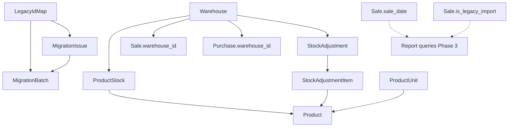

# Phase 2 Handoff — Database Schema Development

> [!IMPORTANT]
> This document provides implementation-ready proposals for Phase 2.
> No schema changes have been made in Phase 1.
> All proposals require review before implementation.

---

## 1. Implementation Sequence

The recommended Phase 2 task order:

1. **Create migration infrastructure models** — LegacyIdMap, MigrationBatch, MigrationIssue
2. **Create Warehouse model** (conditional on DEC-001)
3. **Create StockAdjustment models** — StockAdjustment, StockAdjustmentItem
4. **Add business-date fields** — sale_date, purchase_date
5. **Add legacy import flags** — is_legacy_import on Sale, Purchase, Expense
6. **Add warehouse FKs** (conditional) — warehouse_id on Sale, Purchase
7. **Create ProductUnit model** (conditional on DEC-005)
8. **Create ProductStock model** (conditional on DEC-001 Option A)
9. **Create migration user** (DEC-011)
10. **Run Prisma migration** — single migration for all Phase 2 changes
11. **Backfill existing data** — set defaults for new nullable fields
12. **Validate** — confirm existing application still works

---

## 2. Proposed Prisma Models

### 2.1 LegacyIdMap (MANDATORY)

Maps legacy numeric IDs to NexTill UUIDs for all entity types.

```prisma
model LegacyIdMap {
  id          String   @id @default(uuid())
  entity_type String   // "Sale", "Purchase", "Product", "Customer", etc.
  legacy_id   Int      // Original numeric ID from legacy system
  nextill_id  String   // NexTill UUID
  batch_id    String?  // Which migration batch imported this
  metadata    Json?    // Any additional legacy fields not mapped elsewhere
  created_at  DateTime @default(now())

  batch MigrationBatch? @relation(fields: [batch_id], references: [id])

  @@unique([entity_type, legacy_id])
  @@index([entity_type, nextill_id])
  @@index([batch_id])
}
```

| Field | Type | Notes |
|---|---|---|
| `entity_type` | String | Discriminator: "Sale", "Purchase", "Product", etc. |
| `legacy_id` | Int | Original numeric ID |
| `nextill_id` | String | The UUID assigned in NexTill |
| `batch_id` | String? | FK to MigrationBatch. Nullable for pre-migration manual entries |
| `metadata` | Json? | Catch-all for unmapped legacy fields |
| **Unique** | `@@unique([entity_type, legacy_id])` | Prevents duplicate mappings |
| **Risk** | LOW | New table, no effect on existing data |

### 2.2 MigrationBatch (MANDATORY)

Tracks each migration run for auditability and rollback.

```prisma
model MigrationBatch {
  id             String   @id @default(uuid())
  batch_number   Int      @unique @default(autoincrement())
  source_file    String?  // e.g., "POS_Complete_Export_v4.xlsx"
  source_sha256  String?
  entity_type    String   // Which entity type this batch imported
  record_count   Int      @default(0)
  success_count  Int      @default(0)
  error_count    Int      @default(0)
  status         String   @default("PENDING") // PENDING, RUNNING, COMPLETED, FAILED, ROLLED_BACK
  started_at     DateTime?
  completed_at   DateTime?
  rollback_at    DateTime?
  notes          String?
  created_at     DateTime @default(now())
  updated_at     DateTime @updatedAt

  legacy_id_maps LegacyIdMap[]
  issues         MigrationIssue[]

  @@index([entity_type])
  @@index([status])
}
```

| Field | Type | Notes |
|---|---|---|
| `batch_number` | Int @unique autoincrement | Human-readable sequential batch number |
| `source_sha256` | String? | For workbook verification |
| `status` | String | PENDING → RUNNING → COMPLETED/FAILED/ROLLED_BACK |
| **Risk** | LOW | New table |

### 2.3 MigrationIssue (MANDATORY)

Per-record issue tracking for migration problems.

```prisma
model MigrationIssue {
  id            String   @id @default(uuid())
  batch_id      String
  entity_type   String
  legacy_id     Int?
  severity      String   // ERROR, WARNING, INFO
  issue_type    String   // ORPHAN_CHILD, MISSING_REFERENCE, VALIDATION_ERROR, etc.
  description   String
  source_data   Json?    // The raw legacy record
  resolution    String?  // How it was resolved
  resolved_at   DateTime?
  created_at    DateTime @default(now())

  batch MigrationBatch @relation(fields: [batch_id], references: [id])

  @@index([batch_id])
  @@index([entity_type, legacy_id])
  @@index([severity])
}
```

| **Risk** | LOW | New table |

### 2.4 Warehouse (CONDITIONAL on DEC-001)

```prisma
model Warehouse {
  id          String   @id @default(uuid())
  name        String   @unique
  code        String?  @unique
  address     String?
  is_default  Boolean  @default(false)
  is_active   Boolean  @default(true)
  created_at  DateTime @default(now())
  updated_at  DateTime @updatedAt

  product_stocks    ProductStock[]
  sales             Sale[]
  purchases         Purchase[]
  stock_adjustments StockAdjustment[]

  @@index([is_default])
}
```

| Field | Type | Notes |
|---|---|---|
| `name` | String @unique | e.g., "Main Warehouse" |
| `code` | String? @unique | Short code, e.g., "WH-001" |
| `is_default` | Boolean | Only one warehouse should be default |
| **Existing data** | On migration, create a "Default" warehouse and optionally FK existing records |
| **Risk** | MEDIUM | Requires FK additions to Sale and Purchase |

### 2.5 ProductStock (CONDITIONAL on DEC-001 Option A)

Per-warehouse stock levels. Coexists with Product.quantity initially.

```prisma
model ProductStock {
  id           String   @id @default(uuid())
  product_id   String
  warehouse_id String
  quantity     Decimal  @db.Decimal(14, 3) @default(0)
  created_at   DateTime @default(now())
  updated_at   DateTime @updatedAt

  product   Product   @relation(fields: [product_id], references: [id], onDelete: Restrict)
  warehouse Warehouse @relation(fields: [warehouse_id], references: [id], onDelete: Restrict)

  @@unique([product_id, warehouse_id])
  @@index([warehouse_id])
}
```

| **Existing data** | Backfill: create one ProductStock per Product using default warehouse and current Product.quantity |
| **Compatibility** | Product.quantity remains the source of truth until full multi-warehouse is activated |
| **Risk** | MEDIUM | Must keep Product.quantity in sync until Phase 5+ |

### 2.6 StockAdjustment (MANDATORY)

```prisma
model StockAdjustment {
  id              String   @id @default(uuid())
  adjustment_date DateTime
  warehouse_id    String?
  user_id         String
  reason          String?
  notes           String?
  is_legacy_import Boolean  @default(false)
  created_at      DateTime @default(now())
  updated_at      DateTime @updatedAt

  user      User       @relation(fields: [user_id], references: [id])
  warehouse Warehouse? @relation(fields: [warehouse_id], references: [id])
  items     StockAdjustmentItem[]

  @@index([adjustment_date])
  @@index([warehouse_id])
}
```

### 2.7 StockAdjustmentItem (MANDATORY)

```prisma
model StockAdjustmentItem {
  id              String  @id @default(uuid())
  adjustment_id   String
  product_id      String
  quantity_change Decimal @db.Decimal(14, 3)
  method_type     Int?    // Preserved from legacy, meaning TBD
  unit            String  @default("pcs")
  notes           String?
  created_at      DateTime @default(now())

  adjustment StockAdjustment @relation(fields: [adjustment_id], references: [id], onDelete: Cascade)
  product    Product         @relation(fields: [product_id], references: [id], onDelete: Restrict)

  @@index([adjustment_id])
  @@index([product_id])
}
```

| **Risk** | LOW | New tables. User relation requires adding `stock_adjustments StockAdjustment[]` to User model |

### 2.8 ProductUnit (CONDITIONAL on DEC-005)

Per-product conversion factors for non-standard packaging.

```prisma
model ProductUnit {
  id              String  @id @default(uuid())
  product_id      String
  unit_name       String  // e.g., "pack", "carton"
  conversion_factor Decimal @db.Decimal(14, 6) // How many base units in one of this unit
  is_default      Boolean @default(false)
  created_at      DateTime @default(now())
  updated_at      DateTime @updatedAt

  product Product @relation(fields: [product_id], references: [id], onDelete: Cascade)

  @@unique([product_id, unit_name])
  @@index([product_id])
}
```

---

## 3. Fields to Add to Existing Models

### 3.1 Sale model additions

```prisma
// Add to Sale model:
sale_date       DateTime?       // Historical business date (distinct from created_at)
warehouse_id    String?         // FK to Warehouse (conditional on DEC-001)
is_legacy_import Boolean @default(false) // Flag for imported records

warehouse Warehouse? @relation(fields: [warehouse_id], references: [id])
```

| Field | Default | Nullable | Existing data migration |
|---|---|---|---|
| `sale_date` | null | Yes | Existing sales: set to null (business date = created_at) |
| `warehouse_id` | null | Yes | Existing sales: set to default warehouse ID or null |
| `is_legacy_import` | false | No | Existing sales: already false |

### 3.2 Purchase model additions

```prisma
// Add to Purchase model:
purchase_date    DateTime?       // Historical business date
warehouse_id     String?         // FK to Warehouse
is_legacy_import Boolean @default(false)

warehouse Warehouse? @relation(fields: [warehouse_id], references: [id])
```

### 3.3 Expense model additions

```prisma
// Add to Expense model:
is_legacy_import Boolean @default(false)
```

### 3.4 User model additions

```prisma
// Add to User model:
stock_adjustments StockAdjustment[]
```

### 3.5 Product model additions (conditional)

```prisma
// Add to Product model (if ProductStock and ProductUnit adopted):
product_stocks ProductStock[]
product_units  ProductUnit[]
stock_adjustment_items StockAdjustmentItem[]
```

---

## 4. Indexes and Constraints

| Model | Constraint | Purpose |
|---|---|---|
| LegacyIdMap | `@@unique([entity_type, legacy_id])` | Prevent duplicate legacy ID mappings |
| LegacyIdMap | `@@index([entity_type, nextill_id])` | Reverse lookup |
| MigrationBatch | `batch_number @unique` | Human-readable batch reference |
| ProductStock | `@@unique([product_id, warehouse_id])` | One stock record per product per warehouse |
| ProductUnit | `@@unique([product_id, unit_name])` | One conversion per unit per product |
| Warehouse | `name @unique`, `code @unique` | Prevent duplicate warehouses |
| StockAdjustment | `@@index([adjustment_date])` | Date range queries |

---

## 5. Decimal Precision

| Use case | Precision | Rationale |
|---|---|---|
| Money amounts | `Decimal(10, 2)` | Existing convention, 2 decimal places |
| Quantities | `Decimal(14, 3)` | Existing convention, 3 decimal places |
| Unit conversion factors | `Decimal(14, 6)` | High precision for fractional conversions |

---

## 6. Migration Rollback Approach

1. Each MigrationBatch records all created NexTill UUIDs via LegacyIdMap.
2. To roll back a batch:
   - Query LegacyIdMap for all records with that batch_id.
   - Delete the NexTill records (cascading where appropriate).
   - Set batch status to ROLLED_BACK with rollback_at timestamp.
3. Product.quantity adjustments from rolled-back imports must be reversed.
4. Rollback scripts should be tested in staging before production use.

---

## 7. Dependencies



---

## 8. Mandatory vs Conditional Models

| Model | Mandatory | Condition |
|---|---|---|
| LegacyIdMap | ✅ Yes | — |
| MigrationBatch | ✅ Yes | — |
| MigrationIssue | ✅ Yes | — |
| StockAdjustment | ✅ Yes | Legacy adjustment data exists |
| StockAdjustmentItem | ✅ Yes | Legacy adjustment data exists |
| Warehouse | ⚠️ Conditional | DEC-001 approved |
| ProductStock | ⚠️ Conditional | DEC-001 Option A approved |
| ProductUnit | ⚠️ Conditional | DEC-005 Option B approved |
| Sale.sale_date | ✅ Yes | Required for historical date preservation |
| Sale.is_legacy_import | ✅ Yes | Required for filtering |
| Purchase.purchase_date | ✅ Yes | Required for historical date preservation |
| Purchase.is_legacy_import | ✅ Yes | Required for filtering |
| Expense.is_legacy_import | ✅ Yes | Required for filtering |

---

## 9. Risk Summary

| Risk | Level | Mitigation |
|---|---|---|
| Adding FKs to Sale/Purchase | MEDIUM | Nullable FKs with no default → no breaking change |
| ProductStock vs Product.quantity sync | HIGH | Keep Product.quantity as source of truth initially |
| StockAdjustment User FK | LOW | Add relation array to User model |
| Migration rollback data integrity | HIGH | Test rollback in staging; use transactions |
| Report query changes | MEDIUM | Phase 3 scope; backward-compatible changes |
