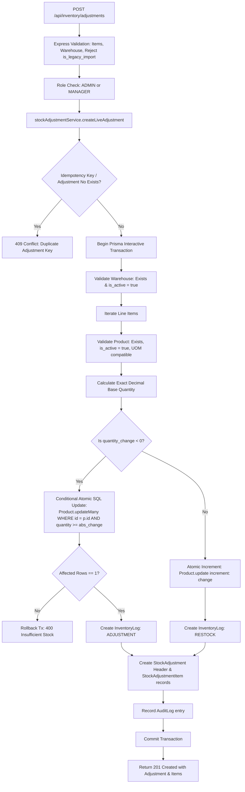

# NexTill POS — Phase 3B Implementation Report
## Transactional Stock Adjustment & Inventory Safety

**Date:** November 22, 2026  
**Git Branch:** `phase-3b/transactional-stock-adjustments`  
**Base Commit / Branch:** `phase-3a/business-dates-and-warehouse-queries`  
**Database Target:** Isolated PostgreSQL 18 Staging Instance (`localhost:5434`, database: `pos_staging`)  
**Status:** **COMPLETE & VERIFIED** (20/20 Test Suites Passing, 251/251 Tests Passing)

---

## 1. Executive Summary

Phase 3B implements a production-grade, concurrency-safe, transactional stock adjustment service for NexTill POS. This service establishes a rigorous operational boundary between **live point-of-sale inventory mutations** and **historical legacy POS data imports**, ensuring data integrity, strict auditability, and total prevention of stock drift.

### Core Objectives Achieved:
1. **Transactional Multi-Item Live Stock Adjustments:**
   - Implemented `createLiveAdjustment` in [stockAdjustmentService.js](file:///C:/Users/shaki/Desktop/NexTill_POS/server/src/services/stockAdjustmentService.js).
   - Atomic all-or-nothing execution wrapped in `prisma.$transaction`.
   - Concurrency protection via atomic conditional stock updates (`updateMany` with `quantity: { gte: decrementAmt }`).
   - Exact Decimal mathematics using `Decimal.js` (via `money.js` and `uom.js`), eliminating floating-point rounding errors.
   - Comprehensive audit logging via `InventoryLog` and `AuditLog`.
2. **Database-Backed Idempotency Protection:**
   - Sequential adjustment number generation (`ADJ-YYYYMMDD-NNNN`) via [generateAdjustmentNumber.js](file:///C:/Users/shaki/Desktop/NexTill_POS/server/src/utils/generateAdjustmentNumber.js).
   - Client-provided idempotency keys mapped to `StockAdjustment.adjustment_number` (`@unique`).
   - Duplicate prevention with `409 Conflict` and database-level unique constraint collision handling.
3. **Strict Historical Import Isolation:**
   - Dedicated historical recording function `recordHistoricalAdjustment` that creates adjustment headers and line items with `is_legacy_import: true` while **strictly bypassing** live `Product.quantity` mutations and **strictly skipping** `InventoryLog` creation.
   - Preserves nullable `product_id` for unresolved legacy items and records raw legacy integer `method_type` codes.
4. **Server-Side Security & Anti-Tampering Hardening:**
   - Audited and secured `POST /api/sales` and `POST /api/purchases` endpoints.
   - Cashiers and normal authenticated users cannot inject `is_legacy_import: true` (express-validator rejects client-supplied flags with `422 Unprocessable Entity`, and controllers enforce strict field allowlists with `is_legacy_import: false`).
   - Business date backdating on sales is strictly restricted to `ADMIN` users; unauthorized backdating attempts are rejected with `403 Forbidden`.
   - User identity is strictly derived from verified JWT authentication context (`req.user.id`), preventing identity spoofing.
5. **Zero Schema Mutations:**
   - Maintained all 28 existing Prisma models and 11 applied migrations without modifying `server/prisma/schema.prisma`.
   - Maintained single global `Product.quantity` as the sole authoritative live inventory counter.

---

## 2. Files Modified and Created

### 2.1 Newly Created Files
- [generateAdjustmentNumber.js](file:///C:/Users/shaki/Desktop/NexTill_POS/server/src/utils/generateAdjustmentNumber.js): Utility generating daily sequential adjustment numbers in format `ADJ-YYYYMMDD-NNNN` with transaction-aware sequence counting.
- [stockAdjustmentService.js](file:///C:/Users/shaki/Desktop/NexTill_POS/server/src/services/stockAdjustmentService.js): Core transactional stock adjustment business logic:
  - `createLiveAdjustment({ warehouse_id, reason, notes, idempotency_key, items }, user)`
  - `recordHistoricalAdjustment(data, batchId)`
  - `getStockAdjustmentById(id)`
  - `listStockAdjustments(filters)`
- [stockAdjustmentController.js](file:///C:/Users/shaki/Desktop/NexTill_POS/server/src/controllers/stockAdjustmentController.js): HTTP controller exposing adjustment creation, retrieval, and filtered listing.
- [stockAdjustmentService.test.js](file:///C:/Users/shaki/Desktop/NexTill_POS/server/src/__tests__/stockAdjustmentService.test.js): Comprehensive integration test suite containing 21 automated test cases covering positive/negative adjustments, concurrency, decimal precision, idempotency, sufficiency checks, security rejections, and historical isolation.
- [phase-3b-implementation-report.md](file:///C:/Users/shaki/Desktop/NexTill_POS/docs/legacy-migration/phase-3b-implementation-report.md): This architectural and operational report.
- [phase-3b-test-results.md](file:///C:/Users/shaki/Desktop/NexTill_POS/docs/legacy-migration/phase-3b-test-results.md): Detailed verification and test results report.
- [phase-3b-inventory-safety.md](file:///C:/Users/shaki/Desktop/NexTill_POS/docs/legacy-migration/phase-3b-inventory-safety.md): Inventory safety, concurrency, precision, and historical isolation architecture specification.

### 2.2 Modified Existing Files
- [inventory.js](file:///C:/Users/shaki/Desktop/NexTill_POS/server/src/routes/inventory.js):
  - Mounted `POST /api/inventory/adjustments` with express-validator checks, rejecting client-supplied `is_legacy_import: true` with 422.
  - Mounted `GET /api/inventory/adjustments/:id` to retrieve adjustment details and items.
  - Restricted adjustment creation and retrieval to `['ADMIN', 'MANAGER']` roles.
- [sales.js](file:///C:/Users/shaki/Desktop/NexTill_POS/server/src/routes/sales.js):
  - Added request validator rejecting client-supplied `is_legacy_import` with 422.
  - Added authorization validator restricting `sale_date` specification to `ADMIN` role.
- [salesController.js](file:///C:/Users/shaki/Desktop/NexTill_POS/server/src/controllers/salesController.js):
  - Enforced explicit allowlist in `createSale`, forcing `is_legacy_import: false`.
  - Derives `user_id` strictly from authenticated session token.
- [purchases.js](file:///C:/Users/shaki/Desktop/NexTill_POS/server/src/routes/purchases.js):
  - Added request validator rejecting client-supplied `is_legacy_import` with 422.
- [purchaseController.js](file:///C:/Users/shaki/Desktop/NexTill_POS/server/src/controllers/purchaseController.js):
  - Enforced explicit allowlist in `create`, forcing `is_legacy_import: false` and `user_id: req.user.id`.
- [warehouseAndBusinessDates.test.js](file:///C:/Users/shaki/Desktop/NexTill_POS/server/src/__tests__/warehouseAndBusinessDates.test.js):
  - Updated integration tests to confirm that live endpoints reject client legacy flags with 422, while verifying historical reporting queries against direct Prisma seed records.

---

## 3. Architecture & Service Design

### 3.1 Live Stock Adjustment Execution Workflow
When an authorized user (`ADMIN` or `MANAGER`) posts an adjustment to `POST /api/inventory/adjustments`:



### 3.2 Concurrency Protection & Sufficiency Guard
To prevent race conditions during high-volume operations (e.g., simultaneous checkout and stock deduction), negative adjustments do not perform a naive read-then-write. Instead, an atomic conditional update is executed:

```javascript
const updateResult = await tx.product.updateMany({
  where: {
    id: item.product_id,
    quantity: { gte: decrementAbs.toNumber() },
  },
  data: {
    quantity: { decrement: decrementAbs.toNumber() },
  },
});

if (updateResult.count === 0) {
  throw new ValidationError(
    `Insufficient stock for product '${product.name}'. Available: ${product.quantity}, requested deduction: ${decrementAbs}`
  );
}
```
If two concurrent requests attempt to decrement stock beyond the available quantity, the database row-level locking ensures that only one request can satisfy the condition `quantity >= decrementAbs`. The losing transaction immediately matches 0 rows, rolls back cleanly, and throws a structured `400 Bad Request` without corrupting balances.

### 3.3 Database-Backed Idempotency Guarantee
Network retries from POS terminals cannot cause duplicate stock deductions:
1. Clients can supply a unique `idempotency_key` (or explicit `adjustment_number`).
2. The service checks for an existing record with that `adjustment_number`.
3. If an existing record is detected, it throws `409 Conflict`.
4. At the database layer, `StockAdjustment.adjustment_number` has a unique constraint (`@unique`). If concurrent requests bypass the initial read check, the database rejects the duplicate transaction with a unique constraint violation (`P2002`).

### 3.4 Strict Isolation of Historical Imports
Historical legacy stock movements are segregated completely from live operational adjustments:
- **Service Endpoint Isolation:** `createLiveAdjustment` strictly executes live stock mutations, requires active products, validates stock sufficiency, updates `Product.quantity`, and records `InventoryLog` entries.
- **Historical Import Method:** `recordHistoricalAdjustment(data, batchId)` records legacy adjustments into `StockAdjustment` and `StockAdjustmentItem` with `is_legacy_import: true`. It **strictly bypasses** `Product.quantity` mutations and **does not create** `InventoryLog` records. This ensures that legacy migration runs do not distort the live inventory balance established during physical stock take.
- **Support for Unresolved Legacy Data:** `recordHistoricalAdjustment` accepts nullable `product_id` for unresolved legacy items, stores raw integer `method_type` codes, and links errors to `MigrationIssue`.

---

## 4. API Endpoints & Contract Matrix

| Endpoint | Method | Auth / Roles | Request Body / Parameters | Behavior |
|---|---|---|---|---|
| `/api/inventory/adjustments` | POST | Authenticated (`ADMIN`, `MANAGER`) | `{ warehouse_id, reason, notes, idempotency_key, items: [{ product_id, quantity_change, unit, notes }] }` | Atomically executes live stock adjustment, updates `Product.quantity`, writes `InventoryLog` & `AuditLog`. Rejects client `is_legacy_import: true` with 422. |
| `/api/inventory/adjustments/:id` | GET | Authenticated (`ADMIN`, `MANAGER`) | Path parameter `:id` (UUID) | Returns adjustment record with embedded warehouse, user, and items. Returns 404 if not found. |
| `/api/inventory/adjustments` | GET | Authenticated (`ADMIN`, `MANAGER`) | Query: `warehouse_id`, `is_legacy_import`, `start_date`, `end_date`, `search`, `page`, `limit` | Lists stock adjustments with filtering and pagination. |
| `/api/sales` | POST | Authenticated (`ADMIN`, `MANAGER`, `CASHIER`) | Standard POS sale payload. Client `is_legacy_import: true` is forbidden. `sale_date` allowed only for `ADMIN`. | Creates live sale, decrements stock atomically, enforces `is_legacy_import: false`. |
| `/api/purchases` | POST | Authenticated (`ADMIN`, `MANAGER`) | Standard purchase order payload. Client `is_legacy_import: true` is forbidden. | Creates live purchase order, increments stock atomically, enforces `is_legacy_import: false`. |

---

## 5. Verification Results Overview

- **Backend Integration Test Suite:** **20 / 20 test suites passed**, **251 / 251 tests passed** (36.38s).
- **Dedicated Phase 3B Test Suite (`stockAdjustmentService.test.js`):** **21 / 21 tests passed** covering all concurrency, sufficiency, decimal precision, idempotency, and security scenarios.
- **Frontend SPA Production Build (`vite build`):** **Clean build** in 2.81s (681 modules transformed, 0 errors).
- **Migration Readiness Check (`check-readiness.js`):** **CONDITIONAL** (10 PASS, 2 WARNING, 0 BLOCKED, 0 ERRORS).
- **Database Safety:** Remote Neon database remained 100% untouched; all testing executed against isolated local PostgreSQL staging on port 5434.

---

## 6. Safety & Integrity Affirmations

1. **Sole Authoritative Balance:** `Product.quantity` remains the sole authoritative real-time inventory counter. No multi-warehouse inventory splitting was introduced.
2. **Atomic Rollbacks:** Any failure during line item validation, stock sufficiency checks, or database constraints causes an immediate and complete rollback of the entire transaction.
3. **Impersonation & Tampering Guard:** Normal API endpoints reject client attempts to set `is_legacy_import: true` or backdate transactions without proper administrative authorization.
4. **Zero Drift Guarantee:** Historical legacy imports do not mutate `Product.quantity` or generate `InventoryLog` entries, preserving live inventory integrity.
