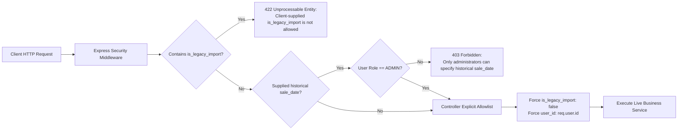

# NexTill POS — Phase 3B Inventory Safety & Concurrency Architecture
## System Specification: Authoritative Balances, Concurrency Guards, and Migration Isolation

**Date:** November 22, 2026  
**Git Branch:** `phase-3b/transactional-stock-adjustments`  
**Prerequisites:** DEC-004 (Adjustment Header/Item Model), DEC-008 (Authoritative Stock Counter)

---

## 1. Authoritative Stock Balance Architecture

### 1.1 Single Global Authoritative Counter
In NexTill POS, **`Product.quantity` is the sole, authoritative, real-time inventory balance**.

```prisma
model Product {
  id               String   @id @default(uuid())
  sku              String   @unique
  name             String
  quantity         Decimal  @default(0) @db.Decimal(14, 3)
  min_stock_level  Decimal? @default(0) @db.Decimal(14, 3)
  // ...
}
```

### 1.2 Rationale for Deferring Multi-Warehouse Inventory Ledgers
During Phase 2 architecture review (DEC-008), the introduction of multi-warehouse stock balances (`ProductStock`) was evaluated and deliberately deferred:
1. **Legacy Source Data Reality:** The legacy POS system operated with a single logical stock counter per product. Legacy data lacks historical opening balances and full transfer logs partitioned by physical warehouse.
2. **Preventing Split-Brain Balances:** Attempting to introduce `ProductStock.quantity` alongside `Product.quantity` without a verified starting point would cause discrepancies between POS checkout balance checks and warehouse ledger views.
3. **Transactional Attribution vs Physical Bin Management:** In NexTill POS, `warehouse_id` on `Sale`, `Purchase`, and `StockAdjustment` records acts as an **auditable transactional tag**. It answers: *"Which warehouse/outlet handled this transaction?"* rather than representing a distinct physical bin ledger.

---

## 2. Concurrency Protection & Sufficiency Guards

### 2.1 The Race Condition Threat
In a multi-terminal retail POS environment, concurrent requests targeting the same product SKU can occur simultaneously:
- A cashier completes a POS checkout decrementing stock.
- An inventory manager submits a stock write-off (negative adjustment) for damaged goods.
- A receiving clerk books a stock intake (purchase order receiving).

If implemented using a naive *read-modify-write* pattern:
```javascript
// NAIVE ANTI-PATTERN - DO NOT USE:
const product = await prisma.product.findUnique({ where: { id } });
if (product.quantity < decrement) throw new Error();
await prisma.product.update({
  where: { id },
  data: { quantity: product.quantity - decrement }, // Lost update & race condition!
});
```
Two overlapping transactions could both read `quantity = 10`, decrement by `8`, and write back `2`, effectively deducting 16 units while only registering a balance drop of 8, causing negative stock drift and financial inventory leakage.

### 2.2 Atomic Conditional Row Updates
Phase 3B resolves this concurrency vulnerability by utilizing **atomic conditional database updates** within interactive transactions (`prisma.$transaction`):

```javascript
// PRODUCTION IMPLEMENTATION in stockAdjustmentService.js:
const updateResult = await tx.product.updateMany({
  where: {
    id: item.product_id,
    quantity: { gte: decrementAbs.toNumber() }, // Atomic sufficiency condition
  },
  data: {
    quantity: { decrement: decrementAbs.toNumber() }, // PostgreSQL atomic decrement
  },
});

if (updateResult.count === 0) {
  throw new ValidationError(
    `Insufficient stock for product '${product.name}'. Available: ${product.quantity}, requested deduction: ${decrementAbs}`
  );
}
```

### 2.3 Guarantees Provided
1. **Row-Level Locking:** PostgreSQL's MVCC applies an exclusive row lock on the matching `Product` row during `UPDATE`.
2. **Atomic Verification:** The `quantity >= decrementAbs` condition is evaluated by PostgreSQL engine at the exact instant the row lock is acquired.
3. **Zero Lost Updates:** Concurrent updates are queued by PostgreSQL; the second transaction evaluates its condition against the updated balance left by the first.
4. **Immediate Transaction Rollback:** If `count === 0`, the service throws a `ValidationError`, instantly causing `prisma.$transaction` to abort and issue a `ROLLBACK`. No partial headers or orphan logs are ever committed.

---

## 3. Exact Decimal Mathematics & Precision

### 3.1 Strict Prohibition of IEEE-754 Floats
Standard JavaScript numbers (`Number`) use 64-bit binary floating-point arithmetic (IEEE-754), which causes representation errors (e.g., `0.1 + 0.2 === 0.30000000000000004`). In retail inventory systems handling fractional quantities (grams, milliliters, meters), float rounding errors cause silent balance divergence.

### 3.2 Fixed-Point Decimal Enforcement
All stock calculations in Phase 3B strictly use `Decimal.js` (wrapped by `server/src/utils/money.js` and `server/src/utils/uom.js`):
- All incoming quantities are parsed into `Decimal` instances.
- Arithmetic is performed using `.plus()`, `.minus()`, `.times()`, `.dividedBy()`.
- Base unit conversion is executed via `toBaseUnitQuantity(quantity, unit, unit_category, base_unit)`.
- Database columns (`Product.quantity`, `StockAdjustmentItem.quantity_change`, `InventoryLog.quantity_change`) are mapped to `Decimal(14, 3)`, guaranteeing exact 3-decimal-place precision (e.g., `0.001` kg / g precision).

---

## 4. Historical Migration Isolation & Anti-Tampering

### 4.1 Threat Model
Allowing client API callers to set migration flags or backdate transactions introduces severe security and operational risks:
1. **Inventory Bypass Fraud:** A rogue cashier or compromised client could submit `{ is_legacy_import: true }` during checkout to complete sales without decrementing stock, concealing theft.
2. **Audit Trail Tampering:** Submitting arbitrary transaction dates could allow backdating sales to manipulate past tax liabilities, cashier shift closures, or financial reports.
3. **Identity Impersonation:** Submitting arbitrary `user_id` fields could attribute stock write-offs to other staff members or automated system identities.

### 4.2 Security Hardening Architecture



### 4.3 Service-Layer Function Segregation
At the application layer, live mutations and historical imports are strictly segregated into distinct functions:

| Characteristic | `createLiveAdjustment` | `recordHistoricalAdjustment` |
|---|---|---|
| **Invocation Context** | Live POS HTTP API (`POST /api/inventory/adjustments`) | Internal CLI migration script (`scripts/migration/`) |
| **`Product.quantity` Mutation** | **YES** (Atomic conditional increment/decrement) | **NO** (Strictly bypassed, balance left untouched) |
| **`InventoryLog` Generation** | **YES** (Records `previous_quantity`, `new_quantity`, `change_type`) | **NO** (Strictly bypassed to avoid polluting operational log) |
| **Product Validation** | Product must exist and have `is_active: true` | Product can be inactive; unmapped items (`product_id: null`) permitted |
| **Warehouse Validation** | Target warehouse must exist and have `is_active: true` | Target warehouse must exist (or falls back to default) |
| **Sufficiency Guard** | Negative changes cannot exceed available stock | Negative changes recorded as historical fact without balance checks |
| **Audit Logging** | Creates `AuditLog` entry tagged with actor's `user.id` | Handled via `MigrationBatch` tracking |

---

## 5. Enum & Schema Evolution Notes

### 5.1 Current Schema Constraint
In `server/prisma/schema.prisma`, `enum InventoryChangeType` is defined as:
```prisma
enum InventoryChangeType {
  SALE
  RESTOCK
  ADJUSTMENT
  RETURN
}
```

### 5.2 Mapping Live Adjustments to `InventoryChangeType`
To maintain strict schema stability without applying unauthorized migrations:
- Positive adjustments (`quantity_change > 0`) are recorded with `change_type: RESTOCK`.
- Negative adjustments (`quantity_change < 0`) are recorded with `change_type: ADJUSTMENT`.
- Specific operational reasons (e.g., `DAMAGE`, `WASTE`, `SPOILAGE`, `THEFT`, `STOCK_COUNT`) are recorded in `InventoryLog.notes` and `StockAdjustment.reason`.

### 5.3 Recommendation for Phase 4 / Phase 5 Schema Evolution
If fine-grained enum values are required in future phases, the following migration can be proposed:
```sql
ALTER TYPE "InventoryChangeType" ADD VALUE IF NOT EXISTS 'DAMAGE';
ALTER TYPE "InventoryChangeType" ADD VALUE IF NOT EXISTS 'WASTE';
ALTER TYPE "InventoryChangeType" ADD VALUE IF NOT EXISTS 'CORRECTION';
```
Until approved by the product owner, the current mapping preserves 100% database compatibility while fully capturing semantic adjustment reasons in the audit trail.
