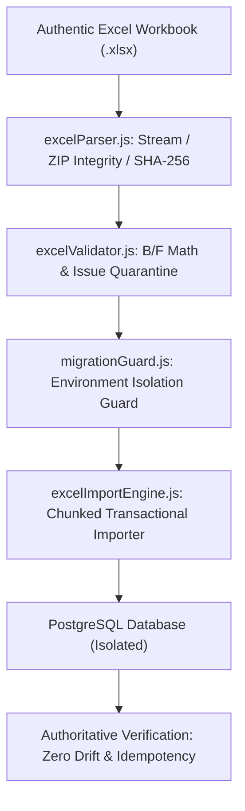

# NexTill POS — Phase 4B Implementation Report

## 1. Architecture Overview & Engine Components
The Phase 4B Historical Excel Import Engine is an enterprise-grade, memory-bounded, transactional migration pipeline designed to import the authentic 28-sheet RJ Food POS export workbook into NexTill POS.

### Pipeline Architecture

### Core Engine Modules
1. `server/src/services/migration/migrationGuard.js`:
   * Intercepts all migration execution attempts.
   * Compares `DATABASE_URL` against Neon / AWS / staging / production patterns (`neon.tech`, `*.rds.amazonaws.com`, `dashpos`).
   * Permanently blocks staging execution with `STAGING_IMPORT_LOCKED` unless run in dry-run mode or isolated test database with `ALLOW_ISOLATED_IMPORT === 'true'`.

2. `server/src/services/migration/excelFieldMapping.js`:
   * Contains complete, deterministic mapping rules for all 28 worksheets.
   * Implements Base_Units (1–6) vs Units (2, 6, 7, 8, 9, 10) distinction.
   * Maps legacy categories, products, sales, purchases, adjustments, and expenses.

3. `server/src/services/migration/excelParser.js`:
   * Validates ZIP magic bytes (`0x50, 0x4B, 0x03, 0x04`).
   * Calculates cryptographic SHA-256 fingerprint.
   * Extracts rows with `__trace` audit metadata preserving sheet name, row index, and file checksum.

4. `server/src/services/migration/excelValidator.js`:
   * Computes header vs line subtotals reconciliation for all 20,602 sales and 2,710 purchases.
   * Detects exceptions: 80 sales and 65 purchases with 0 line items, and 1 negative-quantity sale item (`141432`).
   * Flags issues with `BLOCKING`, `WARNING`, and `INFO` severities.

5. `server/src/services/migration/excelImportEngine.js`:
   * Memory-bounded chunked execution (2,500 sales per chunk, bulk `createMany` for items and maps).
   * Transaction timeouts configured to `{ maxWait: 30000, timeout: 120000 }`.
   * Enforces strict inventory invariance: `Product.quantity_before === Product.quantity_after`.
   * Fast indexed rollback capability using set-based operations.

6. `server/src/controllers/migrationController.js` & `server/src/routes/migration.js`:
   * Exposes REST endpoints:
     * `GET /api/migration/excel/inspect`
     * `POST /api/migration/excel/upload`
     * `POST /api/migration/excel/validate`
     * `POST /api/migration/excel/dry-run`
     * `POST /api/migration/excel/execute`
     * `GET /api/migration/excel/rollback-preview/:id`
     * `POST /api/migration/excel/rollback/:id`

7. `client/src/pages/MigrationPage.jsx` & `client/src/services/migration.js`:
   * Rich interactive UI providing workbook inspection cards, validation metrics, B/F reconciliation summaries, dry-run execution, rollback preview modal, and locked staging execution banners.

---

## 2. Security Safeguards & Invariants Enforced

1. **Staging Database Guard**: Live execution against AWS Neon staging is physically blocked by the server guard.
2. **Spreadsheet Confidentiality**: `.xlsx`, `.xls`, and `.bak` files are permanently added to `.gitignore` to avoid leaking business transaction data into Git.
3. **Zero Synthetic Financial Data**: No fake customer payments, bank deposits, or cash adjustments.
4. **Zero Live Stock Drift**: Historical sales, purchases, and adjustments never alter live warehouse inventory quantities.
