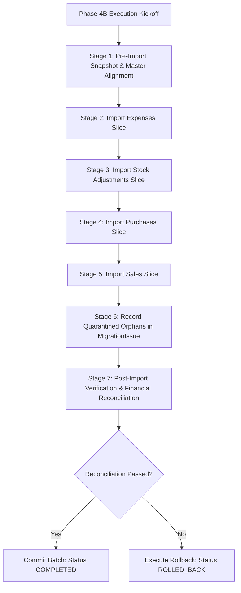

# NexTill POS — Phase 4B Import Readiness
## Pre-Import Gate, Approved Decision Register, and Staged Execution Sequence

**Date:** November 22, 2026  
**Git Branch:** `phase-4a/legacy-migration-engine`  
**Base Commit:** `phase-4a/legacy-migration-engine`  
**Prerequisites:** Phase 4A Dry-Run Validation Passed (`phase-4a-dry-run-report.md`)  
**Status:** **READY FOR PHASE 4B STAGED IMPORT UPON STAKEHOLDER APPROVAL**

---

## 1. Phase 4A Validation Verification Gate

Before proceeding to Phase 4B live database execution, the system must satisfy all safety criteria:

| Gate Check | Required Baseline | Phase 4A Verification Result | Status |
|---|---|---|---|
| **Dry-Run Execution** | Must pass with 0 blocking errors | `runDryRun()` PASSED (10 issues: 0 errors, 9 warnings, 1 info) | **PASSED** |
| **Zero Database Drift** | 0 rows modified during dry run | Exactly 0 records written to PostgreSQL | **PASSED** |
| **Stock Balance Invariance** | `Product.quantity` delta = 0 | Baseline stock verified unchanged before and after dry run & rollback | **PASSED** |
| **Zero Inventory Log Drift**| 0 `InventoryLog` records created | 0 inventory logs created during simulated and rollback runs | **PASSED** |
| **Accounting Invariance** | 0 synthetic `Payment` rows | Direct header balance recording verified | **PASSED** |
| **Orphan Child Quarantine** | 9 orphan items quarantined | 4 purchase orphans + 5 adjustment orphans quarantined into `MigrationIssue` | **PASSED** |
| **Batch Rollback Mechanics**| 100% clean deletion of test batch | `rollbackBatch()` successfully rolled back test batch and cleared all records | **PASSED** |
| **Backend Integration Suite**| 21/21 suites passing | 267 / 267 automated tests passing | **PASSED** |
| **Frontend Production Build**| Clean Vite SPA build | Built in 2.50s with 0 errors | **PASSED** |
| **Migration Readiness Check**| 0 BLOCKED, 0 ERRORS | CONDITIONAL (10 PASS, 2 WARNING, 0 BLOCKED) | **PASSED** |

---

## 2. Outstanding Decisions & Approvals Required

Before executing Phase 4B against a production or shared database, the product owner / stakeholder must formally approve:

1. **Status & Method Code Mappings (DEC-004):**
   - Approval to interpret legacy Sale `status = 1` as `PaymentStatus.COMPLETED`.
   - Approval to interpret legacy Purchase `status = 1` as `PurchaseStatus.RECEIVED`.
   - Approval to preserve raw integer `method_type = 1` on adjustment items.
2. **Master Product Catalog Alignment (DEC-002):**
   - Approval that legacy products (`Sugar`, `Salt`, `Chilli`, `Basmathi Rice`, `ALA`) map to the corresponding existing NexTill SKUs (`S1`, `SLT1`, `CHL`, `BR1`, `AL`).
3. **Master Customer and Supplier Attribution (DEC-003):**
   - Approval to attribute legacy `customer_id = 1` to existing customer record, or leave as null.
   - Approval to attribute legacy `supplier_id = 3` to active supplier `SS-MART`.
4. **Expense Category Fallback (DEC-004 / Field Mapping):**
   - Approval to categorize legacy expense `category_id = 5` ("home") under `Miscellaneous`.
5. **Orphan Quarantine Strategy (DEC-006 & DEC-007):**
   - Formal sign-off that the 4 orphaned purchase items and 5 orphaned adjustment items remain quarantined in `MigrationIssue` rather than attached to arbitrary headers.

---

## 3. Phase 4B Staged Execution Sequence

Phase 4B execution will proceed in strict dependency order:



### Stage-by-Stage Plan:
1. **Stage 1: Pre-Import Snapshot & Master Alignment**
   - Record snapshot of `Product.quantity` across all catalog items.
   - Run `seed-phase2.js` to ensure `migration_import` user and default `WH-001` warehouse exist.
2. **Stage 2: Import Expenses Slice**
   - Ingest 1 expense record ($10,000.00).
   - Verify `LegacyIdMap` created.
3. **Stage 3: Import Stock Adjustments Slice**
   - Ingest 5 stock adjustment headers (5 items).
   - Verify `Product.quantity` remains unchanged.
4. **Stage 4: Import Purchases Slice**
   - Ingest 4 purchase headers (4 items, total $7,650,000.00).
   - Mark `status = RECEIVED` without triggering live receiving hooks.
5. **Stage 5: Import Sales Slice**
   - Ingest 3 sales headers (19 embedded items, total $7,586.65).
   - Set `is_legacy_import = true`, `loyalty_points_earned = 0`.
   - Verify zero stock deductions.
6. **Stage 6: Record Quarantined Orphans**
   - Record 4 purchase orphans and 5 adjustment orphans into `MigrationIssue`.
7. **Stage 7: Post-Import Verification & Reconciliation**
   - Reconcile financial sums:
     - Sales Grand Total: $7,586.65
     - Purchases Grand Total: $7,650,000.00
     - Expenses Total: $10,000.00
   - Confirm `Product.quantity` before === `Product.quantity` after.

---

## 4. Rollback & Contingency Protocol

If any financial discrepancy, foreign key constraint failure, or data anomaly is detected during or after Phase 4B:
1. Run the rollback command:
   ```bash
   node server/scripts/migration/run-migration.js --rollback <batch_id>
   ```
2. The rollback command will:
   - Identify all imported records via `LegacyIdMap`.
   - Atomically delete created sales, purchases, adjustments, and expenses.
   - Delete all `LegacyIdMap` entries associated with the batch.
   - Update `MigrationBatch.status = 'ROLLED_BACK'`.
   - Leave current live inventory and normal POS operational records 100% intact.
