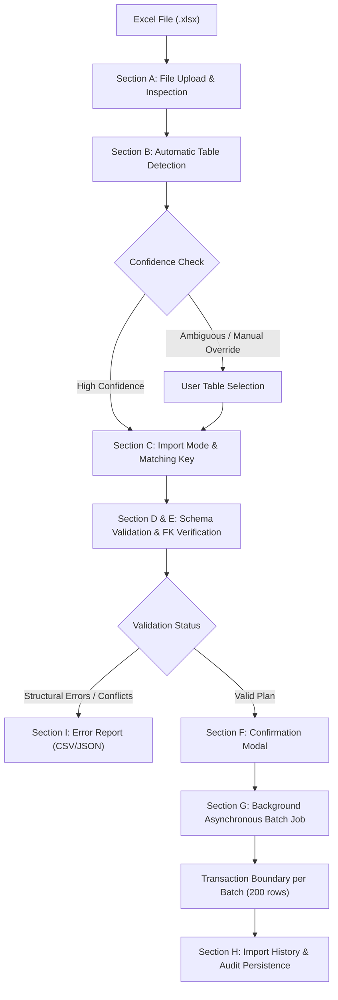
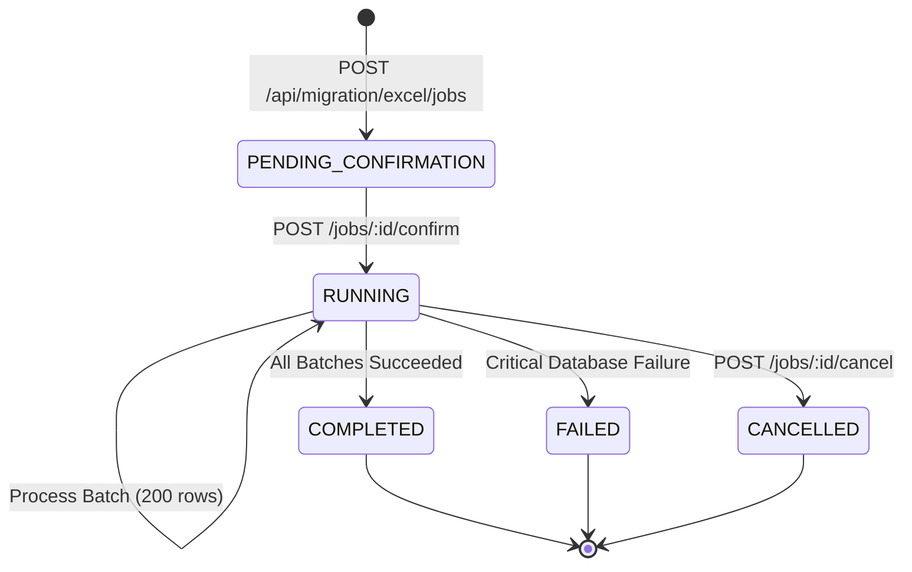

# NexTill POS — Universal Single-Table Excel Migration System Architecture

## 1. System Overview

The NexTill POS Universal Single-Table Excel Migration System is an enterprise-grade, schema-aware data ingestion and synchronization engine designed to import, update, and upsert individual database tables using standard Excel (`.xlsx`) files.

Unlike legacy hardcoded multi-sheet migration scripts, this system dynamically reflects PostgreSQL database metadata and Prisma ORM constraints at runtime. Each uploaded Excel workbook represents **exactly one database table**, with row 1 containing physical database column names.

---

## 2. Core Architectural Principles

1. **Exact Database Column Mapping**:
   - Excel headers must match the physical PostgreSQL database column names exactly.
   - Column renaming or silent column dropping is strictly forbidden. Unknown columns trigger validation rejection.
2. **Schema-Aware Allowlisting**:
   - Only explicitly approved tables (19 tables across Master Data, Inventory, and Financial Operations) are exposed.
   - Sensitive infrastructure tables (User credentials, AuthLogs, Settings, Gateway Settlements) are strictly restricted.
3. **Deterministic Table Detection**:
   - Prioritizes exact worksheet names, sanitized filenames, and column-header signature overlap against the active database schema.
   - Rejects files based only on filename if column headers do not match.
4. **Idempotent & Multi-Mode Execution**:
   - **Insert Only**: Inserts new records; rejects existing primary keys or unique constraint duplicates.
   - **Update Existing**: Matches existing records by primary key or approved unique constraint; updates only supplied columns without modifying primary keys.
   - **Upsert**: Updates existing records and inserts non-existent records.
5. **Business Invariant Protection**:
   - **Stock Safety**: Direct modifications to `Product.quantity` via generic spreadsheets are blocked or warned. Historical sales and purchases never replay live stock deductions or trigger inventory logs.
   - **Financial Invariants**: No synthetic tender payments, refunds, or balancing ledger entries are fabricated.
   - **Historical Tagging**: Historical sales and purchases are automatically stamped with `is_legacy_import = true`.
6. **Asynchronous Batch Processing**:
   - Files are inspected and validated before write execution.
   - Writes run in controlled memory-bounded batches (200 rows) inside isolated database transactions (`prisma.$transaction`).
   - Supports real-time progress polling, throughput calculation, and cancellation checkpoints.

---

## 3. Component Architecture

| Component | File Location | Responsibility |
| :--- | :--- | :--- |
| **Schema Metadata Service** | `server/src/services/migration/universalSchemaService.js` | Introspects Prisma DMMF; extracts approved tables, physical columns, types, nullability, defaults, unique constraints, and foreign key relations. |
| **Table Detector** | `server/src/services/migration/tableDetector.js` | Evaluates header match ratios, required column coverage, sheet names, and filenames to deterministically identify target tables. |
| **Excel Parser** | `server/src/services/migration/universalExcelParser.js` | Parses `.xlsx` workbooks; enforces ZIP header validation, cell bounds limits (ZIP bomb protection), and cell date normalization. |
| **Excel Validator** | `server/src/services/migration/universalExcelValidator.js` | Validates data types, UUID formats, formula injections, nullability, duplicates, and verifies foreign keys against active PostgreSQL tables. |
| **Import Engine** | `server/src/services/migration/universalExcelImportEngine.js` | Manages job lifecycle, executes batched transactions, enforces business invariants, and persists audit logs. |
| **Template Generator** | `server/src/services/migration/templateGenerator.js` | Dynamically generates Minimal and Full `.xlsx` template workbooks with exact physical database column headers and sample data. |
| **Universal Controller** | `server/src/controllers/universalMigrationController.js` | Exposes REST API endpoints for table listing, template downloads, inspection, validation, job execution, and error reporting. |
| **Migration Dashboard** | `client/src/pages/MigrationPage.jsx` | Responsive React interface providing upload, table detection, mode configuration, data preview, validation metrics, progress bars, and history. |

---

## 4. Asynchronous Job State Machine

- **Checkpoint Boundaries**: Batches commit every 200 rows. If cancellation is requested, the current batch finishes cleanly, preventing partial batch corruption.
- **Audit Persistence**: Every job writes a `MigrationBatch` record with JSON-serialized metadata (mode, matching key, operator, counts, duration, throughput) and logs row-level discrepancies into `MigrationIssue`.
