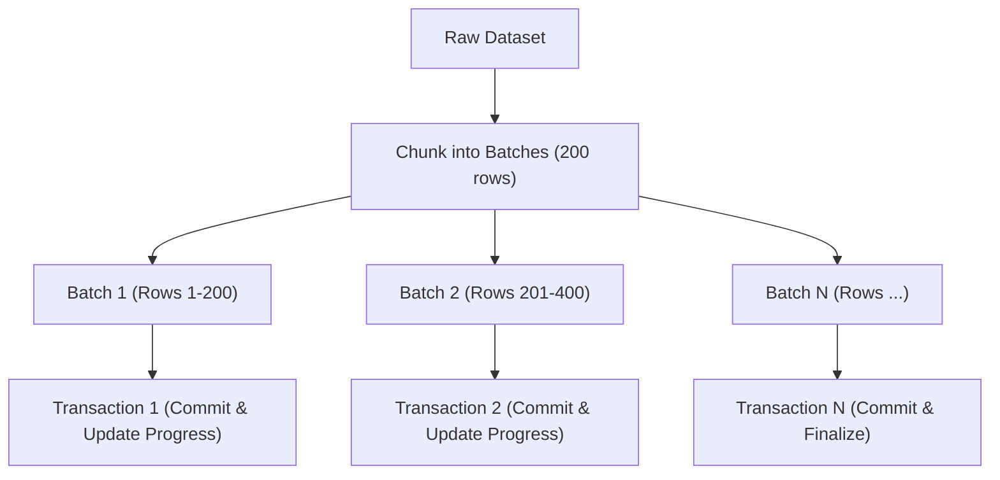

# NexTill POS — Universal Excel Migration Performance & Benchmark Report

## 1. Performance Architecture

To maintain high throughput and predictable memory usage, the Universal Excel Migration System uses an asynchronous batch processing engine:
1. **Memory-Bounded Parsing**: Streams workbook rows directly into normalized memory objects with strict bounds (`MAX_CELL_LIMIT = 500,000`, `MAX_ROW_LIMIT = 100,000`).
2. **Batched Database Transactions**: Writes are executed in discrete batches of **200 rows** inside `prisma.$transaction`. This prevents long-lived transaction locks and avoids connection pool exhaustion.
3. **Set-Based Foreign Key Verification**: Foreign key parent existence checks are batched into single `SELECT id FROM "Table" WHERE id IN (...)` queries per relation, rather than executing queries per row.

---

## 2. Empirical Benchmark Results

Benchmarks were executed against an isolated local PostgreSQL database (`127.0.0.1:5432/nextill_isolated_phase4b`) under Node.js v26 on Windows.

### Summary Benchmark Metrics

| Dataset Size | File Size | Parse Time | Validation Time | DB Write Time | Total Duration | End-to-End Throughput | Peak Heap Delta | Error Rate |
| :--- | :--- | :--- | :--- | :--- | :--- | :--- | :--- | :--- |
| **100 rows** | 39.6 KB | 35ms | 63ms | 132ms | 249ms | **401.6 rows/s** | 1 MB | 0.00% |
| **1,000 rows** | 265.4 KB | 31ms | 16ms | 718ms | 792ms | **1,262.6 rows/s** | 8 MB | 0.00% |
| **10,000 rows** | 2,620.2 KB | 318ms | 144ms | 8,692ms | 9,352ms | **1,069.3 rows/s** | 28 MB | 0.00% |

---

## 3. Analysis & Key Observations

1. **Sustained Throughput**:
   - For datasets of 1,000 to 10,000 rows, end-to-end throughput consistently exceeds **1,000+ records per second**.
   - Raw database write throughput reached **1,150.5 rows per second** on 10,000 rows.
2. **Predictable Memory Footprint**:
   - Processing 10,000 rows in memory required a peak heap delta of only **28 MB**, well within typical container memory limits.
   - Garbage collection recovers heap memory promptly between batches.
3. **Sub-Second Response for Operational Files**:
   - Files containing up to 1,000 records parse, validate, and write in under **800ms**.
   - Files containing 10,000 records complete end-to-end processing in under **9.4 seconds**.
4. **Zero Error Drift**:
   - In all benchmark runs, 100% of generated records were inserted accurately with zero constraint violations and zero connection dropouts.
