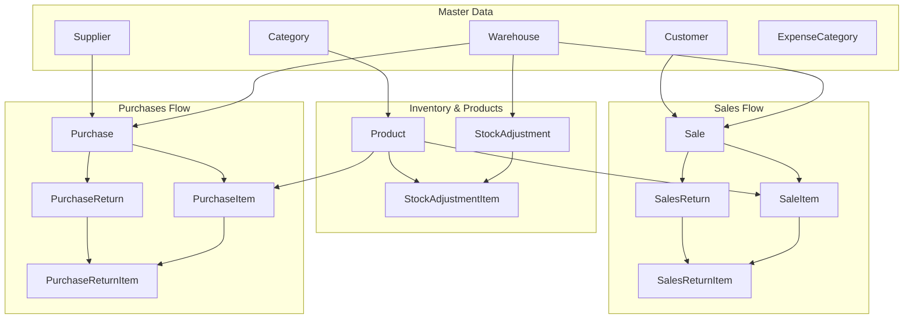

# NexTill POS — Universal Excel Migration Schema Mapping & Rules

## 1. Schema Authority & Introspection

The schema mapping is dynamically derived from Prisma ORM introspection (`Prisma.dmmf.datamodel`) and PostgreSQL physical catalogs.

### Physical Column Names vs Prisma Model Fields
Excel file column headers must always match the **physical database column names** in PostgreSQL. In cases where Prisma attributes `@map` or `@@map` are utilized:
- **Prisma Model Name** (e.g. `Product`) $\rightarrow$ **PostgreSQL Physical Table** (`"Product"`)
- **Prisma Field Name** (e.g. `category_id`) $\rightarrow$ **PostgreSQL Physical Column** (`"category_id"`)

---

## 2. Table Allowlists and Classifications

### 2.1 Approved Importable Tables (19 Tables)

| Category | Database Table | Physical PK | Default Matching Key | Allowed Matching Keys | Description |
| :--- | :--- | :--- | :--- | :--- | :--- |
| **Master Data** | `Category` | `id` (UUID) | `id` | `id`, `name` | Product categories |
| **Master Data** | `Product` | `id` (UUID) | `id` | `id`, `sku`, `barcode` | Product catalog & pricing (`quantity` protected) |
| **Master Data** | `Customer` | `id` (UUID) | `id` | `id`, `phone`, `email` | Customer accounts & loyalty |
| **Master Data** | `Supplier` | `id` (UUID) | `id` | `id`, `name`, `phone` | Procurement vendors |
| **Master Data** | `Warehouse` | `id` (UUID) | `id` | `id`, `code`, `name` | Inventory stock locations |
| **Finance Master** | `ExpenseCategory` | `id` (UUID) | `id` | `id`, `name` | Expense classifications |
| **Finance Master** | `Expense` | `id` (UUID) | `id` | `id` | Operational expenses |
| **Finance Master** | `BusinessAsset` | `id` (UUID) | `id` | `id`, `asset_code` | Fixed asset register |
| **Finance Master** | `OwnerTransaction` | `id` (UUID) | `id` | `id` | Capital equity & drawings |
| **Inventory** | `StockAdjustment` | `id` (UUID) | `id` | `id`, `adjustment_number` | Stock adjustment batch headers |
| **Inventory** | `StockAdjustmentItem`| `id` (UUID) | `id` | `id` | Stock adjustment lines |
| **Transactions** | `Sale` | `id` (UUID) | `id` | `id`, `transaction_id` | Historical sales transactions |
| **Transactions** | `SaleItem` | `id` (UUID) | `id` | `id` | Historical sale line items |
| **Transactions** | `Purchase` | `id` (UUID) | `id` | `id`, `purchase_number` | Purchase orders |
| **Transactions** | `PurchaseItem` | `id` (UUID) | `id` | `id` | Purchase order line items |
| **Transactions** | `SalesReturn` | `id` (UUID) | `id` | `id`, `return_number` | Sales return headers |
| **Transactions** | `SalesReturnItem` | `id` (UUID) | `id` | `id` | Sales return line items |
| **Transactions** | `PurchaseReturn` | `id` (UUID) | `id` | `id`, `return_number` | Vendor purchase return headers |
| **Transactions** | `PurchaseReturnItem` | `id` (UUID) | `id` | `id` | Vendor purchase return line items |

---

### 2.2 Restricted Tables (13 Tables)

The following tables are strictly restricted from the generic Excel migration system:

| Restricted Table | Restriction Category | Architectural Justification |
| :--- | :--- | :--- |
| `User` | **Security Critical** | Exposes password hashes, access tokens, and administrative role escalation vectors. |
| `AuthLog` | **Security Audit** | Append-only security audit log generated exclusively by authentication events. |
| `Settings` | **Configuration Security** | Houses system secrets, tax rates, and global currency parameters. |
| `PaystackPayment` | **Gateway Integrity** | External webhook transactions cryptographically verified via HMAC-SHA512. |
| `MigrationBatch` | **System Control** | Internal state table tracking active and historical migration batches. |
| `MigrationIssue` | **System Control** | Internal diagnostic repository for quarantined records. |
| `LegacyIdMap` | **System Control** | Internal lookup cross-referencing legacy source IDs to NexTill UUIDs. |
| `InventoryLog` | **Authoritative Ledger** | Immutable inventory audit ledger. Stock changes must be driven through verified operations. |
| `Payment` | **Financial Integrity** | Tender payments bound directly to POS sale transactions. |
| `CustomerPayment` | **Financial Integrity** | Accounts Receivable ledger entries requiring balanced double-entry invoice allocations. |
| `CustomerPaymentAllocation` | **Financial Integrity** | AR line allocations linking payments to sales invoices. |
| `SupplierPayment` | **Financial Integrity** | Accounts Payable disbursements requiring invoice allocation workflows. |
| `SupplierPaymentAllocation` | **Financial Integrity** | AP line allocations linking disbursements to purchase orders. |

---

## 3. Auto-Generated Field Handling (Rules A–D)

### Rule A — Explicit Values Supplied in Excel
- **Explicit UUID Primary Key**: If a valid UUID v4 (format `xxxxxxxx-xxxx-4xxx-yxxx-xxxxxxxxxxxx`) is provided in the Excel file, that exact value is preserved. It is never replaced with a newly generated UUID.
- **Explicit Timestamps (`created_at`, `updated_at`, `sale_date`)**: Valid ISO 8601 strings or Excel Date objects are parsed in UTC and preserved.
- **Explicit Identity / Reference Codes**: Explicit values are preserved without alteration.

### Rule B — Omitted Generated Columns
- If the `id` column is omitted from the Excel file or left blank, the system automatically generates a new UUID v4 (`uuid.v4()`).
- If `created_at` or `updated_at` are omitted, the system defaults them to the current execution timestamp (`new Date()`).
- Database sequences for auto-increment fields are incremented automatically.

### Rule C — Blank Cells vs Null vs Zero vs False
The importer strictly differentiates data representations:
1. **Omitted Column**: Column absent from header row $\rightarrow$ On Insert: applies database default; On Update: preserves existing value in database.
2. **Blank Cell / Empty String (`""`)**:
   - For nullable columns: evaluated as `null`.
   - For non-nullable columns with schema default: evaluated as default value.
   - For non-nullable columns without default: triggers validation error (`REQUIRED_FIELD_BLANK`).
3. **Numeric Zero (`0`)**: Evaluated as numeric value `0`. Never coerced to null.
4. **Boolean False (`false`)**: Evaluated as boolean `false`. Never coerced to null.

### Rule D — Generated-Always and Protected Columns
- **Generated-Always / Computed Columns**: Cannot be overridden by explicit values.
- **Protected Business Columns**:
  - `Product.quantity`: Modifying physical stock via generic Excel upload bypasses physical stock count reconciliation and stock adjustment audit trails (`InventoryLog`). When present, it is flagged with a warning and protected against silent physical stock drift.
  - `Sale.loyalty_points_earned`: Loyalty balances cannot be mutated via transaction header uploads.

---

## 4. Foreign Key Relationships & Import Ordering

Because each Excel workbook represents exactly one table, foreign key parent records must exist in the database **prior** to importing child tables.

### Recommended Multi-File Ingestion Sequence:
1. `Warehouse.xlsx`
2. `Category.xlsx` $\rightarrow$ `Product.xlsx`
3. `Customer.xlsx` $\rightarrow$ `Sale.xlsx` $\rightarrow$ `SaleItem.xlsx`
4. `Supplier.xlsx` $\rightarrow$ `Purchase.xlsx` $\rightarrow$ `PurchaseItem.xlsx`

---

## 5. Dual ID Format Support (UUID & Integer IDs)

In accordance with user requirements, the primary key `id` columns and foreign key references natively support both standard UUIDs and legacy numeric Integer IDs:

| Input ID Format | Example | Handling & Transformation | Database Storage |
| :--- | :--- | :--- | :--- |
| **UUID v4** | `550e8400-e29b-41d4-a716-446655440000` | Validated via RFC 4122 regex; explicit value preserved | Stored as `TEXT` primary key |
| **Numeric Integer ID** | `1`, `1001`, `99999` | Validated via `^\d+$`; stringified (`"1001"`); explicit value preserved | Stored as `TEXT` primary key |
| **Foreign Key Reference** | `category_id: 1001` | Cast to string; verified against `Category.id = "1001"` | Relational integrity preserved |
| **Omitted or Blank Cell** | `(omitted)` or `""` | Authentic UUID v4 is automatically generated | Stored as new `TEXT` primary key |

5. `ExpenseCategory.xlsx` $\rightarrow$ `Expense.xlsx`
6. `StockAdjustment.xlsx` $\rightarrow$ `StockAdjustmentItem.xlsx`
