# NexTill POS — Universal Excel Migration Security & Hardening Specification

## 1. Security Architecture & Threat Model

The Universal Single-Table Excel Migration System performs write operations directly against the PostgreSQL database. As such, multiple layers of defense-in-depth are enforced to protect system integrity, prevent privilege escalation, thwart injection attacks, and isolate production environments.

```mermaid
flowchart LR
    A["Client Request"] --> B["1. JWT Authentication"]
    B --> C["2. Role Authorization (ADMIN Only)"]
    C --> D["3. Multer .xlsx Validation (30MB Limit)"]
    D --> E["4. ZIP Magic Header & Bomb Checks"]
    E --> F["5. Table Allowlist Enforcement"]
    F --> G["6. Column Allowlist & Type Validation"]
    G --> H["7. Formula Sanitization (=, +, -, @)"]
    H --> I["8. Parameterized Prisma Operations"]
    I --> J["PostgreSQL Database"]
```



---

## 2. Authentication & Authorization

1. **JWT Verification**:
   - Every migration endpoint requires a valid JWT Bearer access token issued by the NexTill authentication service.
   - Unauthenticated requests are immediately rejected with HTTP `401 Unauthorized`.
2. **Administrative Role Restriction**:
   - Migration endpoints strictly enforce `authorize(['ADMIN'])`.
   - Cashiers, Managers, and non-administrative staff receive an HTTP `403 Forbidden` response.
3. **Session Invalidation**:
   - Access tokens expire every 15 minutes. Long-running batch imports maintain progress asynchronously on the backend regardless of token expiration.

---

## 3. Spreadsheet Injection & File Validation

### 3.1 ZIP Bomb and Decompression Protection
- **Extension Check**: Only files ending with `.xlsx` are accepted. Legacy `.xls` formats are rejected.
- **Magic Number Validation**: The file stream must begin with the standard ZIP local file header signature (`0x50, 0x4B, 0x03, 0x04`). Corrupted archives or disguised executables are rejected with `CORRUPTED_XLSX`.
- **Dimensional Limits**:
  - Maximum File Size: **30 MB** (enforced by Multer streaming limits).
  - Maximum Total Cells: **500,000 cells** per sheet.
  - Maximum Data Rows: **100,000 rows**.
  - Maximum Columns: **200 columns**.
  - Files exceeding these boundaries are rejected before full in-memory parsing.

### 3.2 Formula Injection (CSV/Excel Formula Injection Mitigation)
Spreadsheet applications (e.g., Microsoft Excel, Google Sheets, LibreOffice Calc) automatically interpret cells beginning with formula trigger symbols (`=`, `+`, `-`, `@`) as executable formula expressions, creating DDE (Dynamic Data Exchange) and remote code execution vulnerabilities when exported reports are opened by administrators.

- **Formula Detection Policy**:
  Any cell beginning with `=([a-zA-Z]`, `+([a-zA-Z]`, `-([a-zA-Z]`, or `@([a-zA-Z]` is flagged as an unsafe formula expression.
- **Sanitization Policy**:
  - Formulas are neutralized by prepending a single quote (`'`), ensuring spreadsheet software treats them as literal text strings without formula execution.
  - In validation reports, cell values triggering injection patterns are flagged with code `FORMULA_INJECTION_DETECTED`.

---

## 4. Database Injection & Identifier Allowlisting

1. **Zero Raw SQL String Interpolation**:
   - All database reads, writes, and foreign-key checks are mediated through Prisma ORM using parameterized queries (`prisma[modelName].create`, `update`, `findMany`).
   - User-supplied table names and column names are **never** interpolated into SQL queries.
2. **Strict Backend Column Allowlist**:
   - The allowed column list for each table is introspected directly from `Prisma.dmmf.datamodel`.
   - If an uploaded spreadsheet includes headers that do not exist in the schema, the importer immediately reports `UNKNOWN_COLUMNS_DETECTED` and halts execution.

---

## 5. Table Allowlists and Protected Fields

### 5.1 Enforced Table Allowlist
The backend maintains an explicit allowlist of 19 tables (`universalSchemaService.js`). Any attempt to inspect, validate, or import into any table not on the approved list (e.g., `User`, `AuthLog`, `Settings`, `PaystackPayment`) is blocked with an explicit error:
```
Table "User" is restricted and not approved for universal Excel import.
```

### 5.2 Protected Column Policy
Even on approved tables, business invariants must not be bypassed by generic imports:
- **`Product.quantity`**: Physical stock quantities cannot be overwritten through spreadsheet imports. Modifying physical stock without physical counting and audit logs creates inventory discrepancies. Protected with code `PROTECTED_FIELD_VIOLATION`.
- **`Sale.loyalty_points_earned`**: Loyalty points earned by customers cannot be forged via raw transaction uploads.

---

## 6. Temporary File Management & Cleanup

1. Uploaded files are written to a dedicated, unexposed directory: `server/uploads/`.
2. As soon as the single-table workbook is inspected and parsed into structured memory, the temporary file is deleted synchronously using `fs.unlinkSync()`.
3. If an inspection fails or throws an exception, the `finally` block guarantees temporary file deletion, preventing disk exhaustion.
