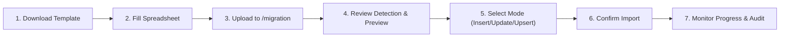

# NexTill POS — Universal Single-Table Excel Migration User Guide

Welcome to the NexTill POS **Database Migration** system (`http://localhost:5173/migration`). This guide explains how store administrators and data managers can safely import, update, and manage data across individual database tables using standard Excel (`.xlsx`) files.

---

## 1. Quick Start Workflow

---

## 2. Step-by-Step Instructions

### Step 1: Download an Approved Excel Template
1. Open your browser and navigate to: [http://localhost:5173/migration](http://localhost:5173/migration).
2. Click the **Download Templates & Schema** tab.
3. Select your desired table from the **Target Table** dropdown (e.g. `Product`, `Customer`, `Supplier`, `Category`).
4. Select a template variant:
   - **Minimal Template**: Contains only the essential required writable columns needed to create a new record.
   - **Full Template**: Contains all supported columns for the table.
5. Click **📥 Download .xlsx Template**.

### Step 2: Prepare Your Spreadsheet
1. Open the downloaded `.xlsx` template in Microsoft Excel, Google Sheets, or LibreOffice.
2. **Do not modify row 1**: Row 1 contains the exact physical database column names.
3. Review sample data in rows 2 and 3, then replace them with your actual records.
4. **Primary Keys (`id`)**:
   - If you have an existing UUID, paste it into the `id` column.
   - If you want the system to generate a new unique UUID automatically, leave the `id` cell blank or omit the column.
5. **Timestamps (`created_at`, `sale_date`)**:
   - Format dates as ISO strings (e.g. `2026-01-15T10:30:00Z`) or standard Excel Date cells.
   - If `created_at` is left blank, the current date/time is automatically assigned.
6. **Foreign Keys (e.g. `category_id`, `supplier_id`)**:
   - Must reference an existing record in the parent table. Make sure to import parent tables (like Categories) before child tables (like Products).
7. Save the workbook as `.xlsx`.

### Step 3: Upload and Automatic Table Detection
1. In the **Universal Excel Import** tab, drag and drop your `.xlsx` file into **Section A — Upload Excel File**, or click to browse.
2. The system automatically inspects your workbook:
   - **Section B — Automatic Table Detection** shows the detected table, matching columns, and confidence rating (**HIGH CONFIDENCE**, **AMBIGUOUS**, or **UNMATCHED**).
   - If detection is ambiguous, you can select the target table from the dropdown.

### Step 4: Choose Import Mode & Matching Key
Under **Section C — Import Mode & Matching Key**, select the desired operation:
- **Insert Only (Default)**: Creates new records. If any record has an ID or unique key that already exists in the database, it will be safely flagged as a conflict without overwriting.
- **Update Existing**: Updates existing records in the database. Requires a matching primary key or unique identifier (e.g., `sku` for Products, `phone` for Customers). Does not create missing records.
- **Upsert**: Updates records that already exist in the database, and inserts records that are new.

### Step 5: Review Data Preview & Validation Summary
1. **Section D — Data Preview**: Displays the first records with their detected column types and per-row validation status:
   - 🟢 `INSERT_CANDIDATE`: Ready to insert.
   - 🔵 `UPDATE_CANDIDATE`: Ready to update.
   - 🟠 `CONFLICT`: Primary key or unique constraint conflict in database.
   - 🔴 `INVALID`: Validation error (e.g., missing parent record, invalid format).
2. **Section E — Validation Summary**: Shows total rows, valid rows, invalid rows, and a list of specific row-level messages with recommended corrections.

### Step 6: Confirm and Execute
1. In **Section F — Import Confirmation**, click **Confirm & Execute Import**.
2. A confirmation modal will appear summarizing target table, mode, and expected insert/update counts.
3. Click **Execute Import Plan** to begin writing to the database.

### Step 7: Monitor Live Progress & Audit
1. **Section G — Import Job Progress** displays a real-time progress bar, records processed, records inserted/updated, elapsed time, and processing throughput (rows/sec).
2. If needed, you can click **Cancel** to halt the job safely at the next batch boundary.
3. When complete, review **Section H — Import History & Audit** to view historical batch records.
4. If any records had errors, click **Download Errors (CSV)** to download an itemized error report.

---

## 3. Protected Columns and Business Invariants

- **Product Inventory (`Product.quantity`)**:
  Generic spreadsheet imports cannot be used to silently alter physical stock on shelves. Inventory adjustments must be performed through the **Stock Adjustment** module to maintain accurate inventory count ledgers (`InventoryLog`).
- **Historical Transactions (`Sale`, `Purchase`)**:
  Historical sales and purchases imported via Excel are automatically tagged with `is_legacy_import = true`. They do not create fake payments or replay automatic inventory stock deductions.

---

## 4. Troubleshooting Common Validation Errors

| Error Code | Meaning | Recommended Action |
| :--- | :--- | :--- |
| `UNKNOWN_COLUMNS_DETECTED` | Column name in row 1 does not exist in database table. | Check spelling or download a fresh template to get exact database column names. |
| `MISSING_REQUIRED_COLUMNS` | A required non-nullable column with no default value is missing. | Add the required column to your spreadsheet. |
| `FOREIGN_KEY_NOT_FOUND` | An ID refers to a parent record that does not exist. | Ensure the parent record exists in the database before importing child items. |
| `FORMULA_INJECTION_DETECTED` | A cell begins with `=`, `+`, `-`, or `@`. | Remove formula expressions; provide literal data values. |
| `UNIQUE_KEY_CONFLICT` | A record with the same unique key already exists. | Switch import mode to **Upsert** or **Update Existing**. |
